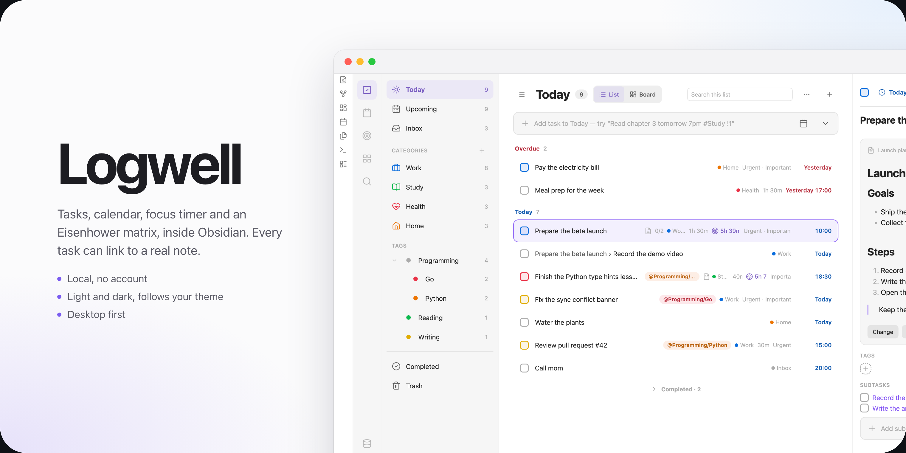
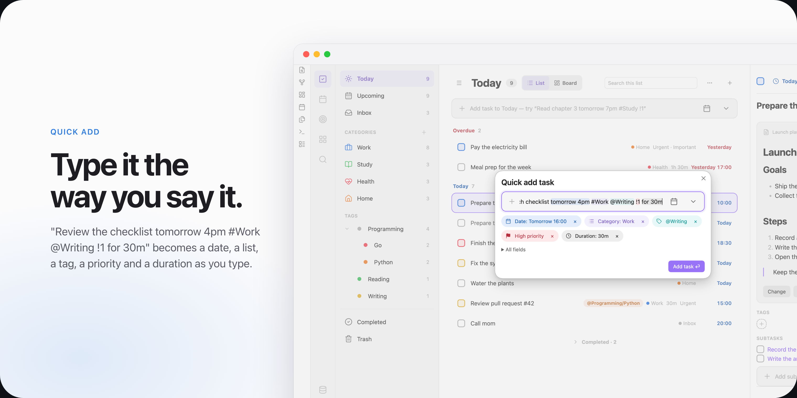
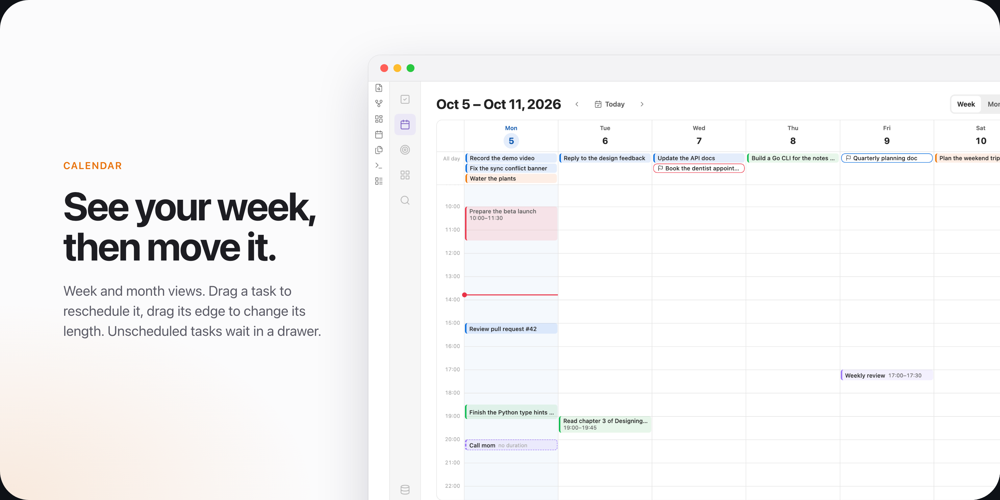
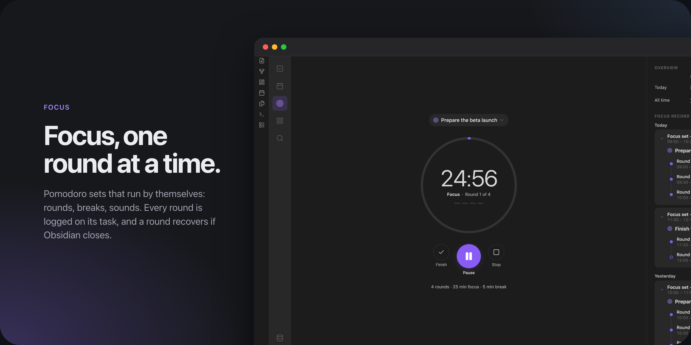
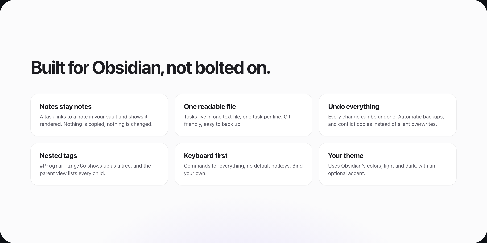

# Logwell

Logwell is a task manager for Obsidian. It brings tasks, a calendar, an Eisenhower matrix, a focus timer and habits into one tab, and keeps all of it in one database file in your vault.

It is for people who plan their days in Obsidian and want their tasks next to their notes, without turning every task into a note. You type a task as a sentence, and Logwell finds the date, list, tags and priority in it. Most changes can be undone.

Logwell runs on Obsidian for desktop.

## Features

- [Tasks](docs/tasks.md) with dates, times, deadlines, durations, priorities, subtasks and a linked description note.
- [Quick Add](docs/quick-add.md) reads a line such as `Pay rent friday #Home @errands !1` as you type.
- [Lists, sections and tags](docs/lists-and-tags.md), with nested tags and a [board](docs/board.md) of columns.
- [Views](docs/views.md): Today, Upcoming, Inbox, Completed and Trash, with sorting, grouping and search.
- [Repeating tasks](docs/repeating-tasks.md) that stay one task and keep their history.
- A [calendar](docs/calendar.md) with week and month views, where you drag tasks to reschedule them.
- An [Eisenhower matrix](docs/matrix.md) that sorts tasks by urgency and importance.
- [Focus](docs/focus.md): timed rounds with breaks, and a [record](docs/focus-record.md) of every round.
- [Habits](docs/habits.md) with check-ins, streaks, goals and [reminders](docs/habit-reminders.md).
- A [task block](docs/dashboard-block.md) that shows a live list of tasks inside any note.
- Optional [TickTick sync](docs/ticktick-sync.md), off until you turn it on. See [Privacy](docs/privacy.md).

  
  

  
  

## Install

Logwell is not in the community plugin directory. Install it by hand:

1. Download `main.js`, `manifest.json` and `styles.css` from the [latest release](https://github.com/MHElnour/checkpoint/releases).
2. Put them in `<your vault>/.obsidian/plugins/logwell/`. Create the folder if it does not exist.
3. In Obsidian, open Settings, then Community plugins. Turn on community plugins if they are off, reload the list and turn on Logwell.
4. Choose **Create database** in the notice that appears.

[Getting started](docs/getting-started.md) walks you through these steps and your first task.

## Your data

Your tasks stay in your vault, in one plain text file that works with Git and file-sync tools. Logwell keeps backups and never copies your notes into it. See [Your data](docs/your-data.md).

## Documentation

- [Documentation](docs/README.md): every page, from first steps to reference.
- [Release notes](docs/releases/README.md): what changed in each release.

## License

Logwell is released under the [MIT License](LICENSE).
