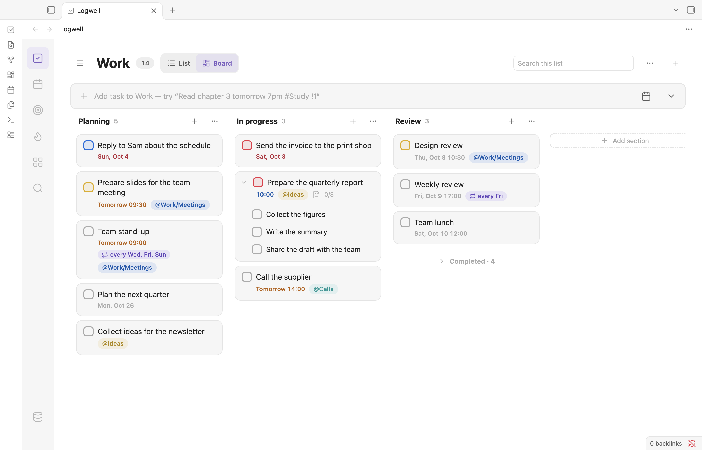

# Board

The board shows a view as columns of cards, so you can see where everything stands and move tasks with a drag. In a list, each section is a column. In Today and Upcoming, each day is a column.

<picture>
  <source media="(prefers-color-scheme: dark)" srcset="images/board-dark.png">
  
</picture>

## Open the board

Today, Upcoming, Inbox and every list have a **List** and **Board** switch in the header. Click **Board**. Each view keeps its own choice while the Logwell tab is open.

| View | Columns |
| --- | --- |
| Today | Your [habits](habits.md), when a habit is active today (it reads "Nothing scheduled today" when none is due). Overdue, when something is overdue. Then Today. |
| Upcoming | One column per day, from tomorrow, empty days included. |
| Inbox and lists | "No section", then each section, then **Add section** (hidden while the database is read-only). |

To create sections, see [Lists, sections and tags](lists-and-tags.md#add-a-section).

## Read a card

A card shows the task's title, with its date, list, tags, note and subtask count on a second line. Click a card to open its details. A subtask sits inside its parent's card when both are in the same column; the chevron folds it away. Otherwise the subtask has its own card, with the parent's name in front.

Each column except Overdue has a plus button that adds a task to that column.

## Move cards between columns

- Drag a card to another day to reschedule it. It keeps its time.
- Drag an overdue card to Today to move its date to today. Its deadline moves too when both its schedule and deadline are past.
- Drag a card to a section column to move it into that section.

The Overdue column takes no drops, and a subtask stays with its parent. Press Escape to cancel a drag. Every move shows a notice with **Undo**.

## Reorder cards and columns

Drag a card up or down within its column. This works when the sort is **Sort: default**. The order is shared by every view: moving a task up in Today also moves it up in its list. See [Views](views.md) for sorting.

In a list, drag a section column's header to move the section. "No section" stays first.

## See completed tasks

Every task column except Overdue ends with its own Completed group. See [Views](views.md) for how the group works.

## Move cards with the keyboard

With a card focused:

- Alt+Left and Alt+Right move it to the next column.
- Alt+Up and Alt+Down move it within its column, under **Sort: default**.

Focus stays on the card after the move.
