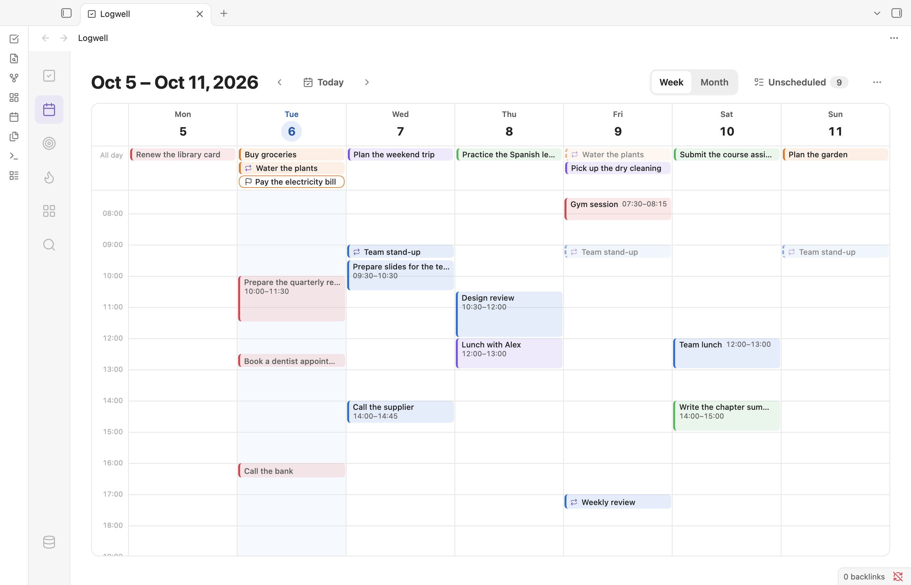
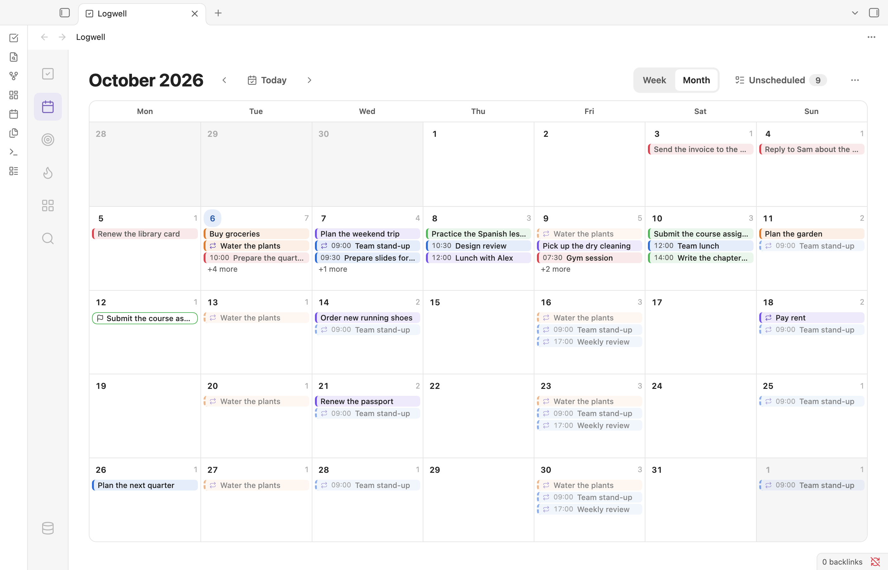

# Calendar

The calendar shows your scheduled tasks by day and hour, so you can see what each day holds and move work around by dragging it. Open it with **Calendar** in the rail or the **Open calendar** command.

<picture>
  <source media="(prefers-color-scheme: dark)" srcset="images/calendar-week-dark.png">
  
</picture>

## Move between weeks and months

The header shows the range you are looking at, such as "Oct 5 – Oct 11, 2026" or "October 2026".

- **Previous week** and **Next week** step one week. In the month view they are **Previous month** and **Next month**, and a step opens on the 1st, or on today in the current month.
- **Today** returns to the week or month that holds today.
- **Week** and **Month** switch the view.

The week starts on the day you pick in the **Week starts on** setting. See [Settings and commands](settings-and-commands.md).

The calendar remembers its view, the range, your filters and the scroll position while you visit other sections.

## Choose what the calendar shows

The calendar shows every task and subtask that has a date or a deadline in the range. To narrow it, open **View options**, the ⋯ button at the end of the header:

- **Lists…** and **Tags…** tick the lists and tags to show. You can pick several in a row. A dot on the button means the calendar is narrowed.
- **Show completed** adds completed tasks, faint and struck through. It is off by default, so a task leaves the calendar when you complete it.

## Read the week view

Each day is a column with 24 hour rows. The grid opens at about 07:00, or an hour before the current time when today is in view. Today's column is highlighted, and a line marks the current time.

- **Timed tasks** are blocks at their time. A block is as tall as the task's planned duration. A task with a time but no duration gets a half-hour block with a dashed edge, marked "no duration". Overlapping blocks sit side by side. A block that runs past midnight continues at the top of the next day.
- **The all-day row** at the top lists tasks that have a date but no time, and deadlines, marked with a flag. A day shows three entries, then "+k more", which expands the whole row. **Show less** collapses it.
- **Daylight saving.** On the day the clocks go forward, the skipped hour is hatched. On the day they go back, the repeated hour is marked "×2".

Entries take the color of their list. Open tasks whose date or time has passed are muted with a red edge, and missed deadlines are red.

## Read the month view

<picture>
  <source media="(prefers-color-scheme: dark)" srcset="images/calendar-month-dark.png">
  
</picture>

The month view shows the whole weeks around the month. Each day shows how many entries it has and lists up to three: tasks with a date, then timed tasks with their start time, then deadlines. Then comes "+k more". Click the day number or "+k more" to open that week.

## Open a task

Click an entry, or focus it and press Enter or Space, to open its details. Change its date or time there and the entry moves. See [Edit a task in the details pane](tasks.md#edit-a-task-in-the-details-pane).

## Move a task to another day or time

Drag an entry with the mouse or a pen. Each drop is one change, with an Undo notice.

- **A timed block** moves to another day or time. Times snap to 15 minutes. The task keeps its duration. For a block that runs past midnight, drag either part.
- **An all-day entry** moves to another day in the all-day row and stays without a time.
- **In the month view** drag an entry to another day. A timed task keeps its time.

A timed block cannot go onto the all-day row, and an all-day entry cannot go onto the hour grid. The calendar marks such a spot as refused and the drop does nothing. Deadline flags and repeating tasks cannot be dragged. To change them, use the details pane. A drop works from the task as it is when you let go, so a change that came in during the drag, such as from TickTick sync, is kept; a task that started repeating during the drag does not move.

Touch drag is not supported. On a touch screen, use the details pane to change dates.

## Change how long a task takes

Drag the bottom edge of a timed block. The planned duration changes in 15-minute steps, with a minimum of 15 minutes, and the block cannot run past midnight. A block that already runs past midnight has no edge to drag: change its duration in the details pane.

## Schedule a task from the Unscheduled drawer

**Unscheduled** in the header, with a count, opens a drawer of open tasks that have no date. Tasks with only a deadline are listed too. Repeating tasks never are. The drawer follows the view options.

Drag a task from the drawer onto the calendar:

- Onto an hour in the week view, to give it that day and time. If it has a planned duration, the block uses it.
- Onto the all-day row or a day in the month view, to give it that date with no time.

You can also click a task to open its details, or tick its checkbox to complete it. Press Escape in the drawer, or **Close unscheduled tasks** (the x button) to close the drawer.

## Use the calendar in a narrow window

In a narrow window, the Unscheduled drawer and the details pane float over the grid. The drawer hides while the details pane is open. Dropping a task onto either panel does nothing. Below 800 pixels wide, the week scrolls sideways and the month view hides the times.

## Repeating tasks

A repeating task shows every occurrence in the range with a repeat icon. See [Repeating tasks](repeating-tasks.md#in-lists-and-the-calendar).
