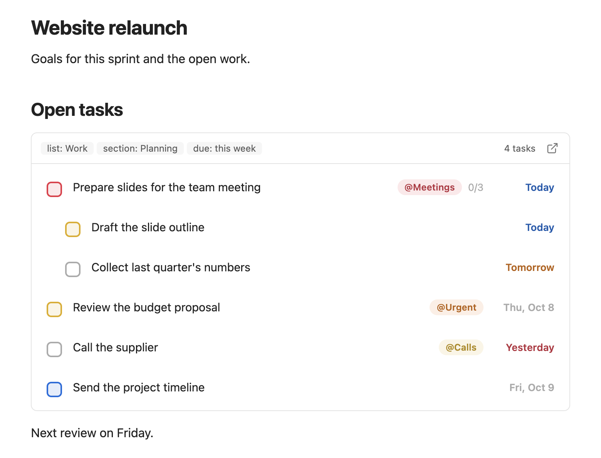
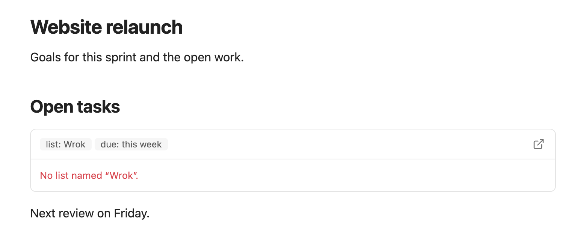
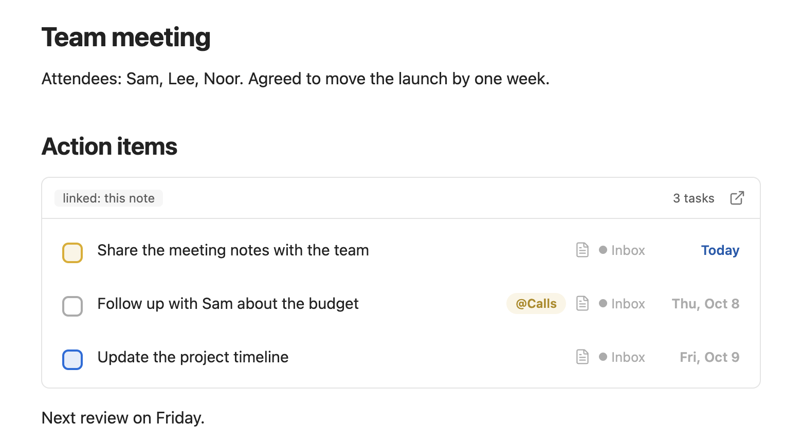

# Task block in notes

A task block puts a live list of your open tasks inside a note, such as a project note or a daily page. It shows the tasks that match the filters you write and updates by itself.

<picture>
  <source media="(prefers-color-scheme: dark)" srcset="images/block-dashboard-dark.png">
  
</picture>

From the block you can complete a task or open it in Logwell. You add, edit and reorder tasks in the app.

## Add a block to a note

Type a code block with the language `logwell`, and write one filter per line:

````
```logwell
list: Work
section: Planning
scheduled: this week
```
````

Move the cursor out of the block in Live Preview, or switch to reading view, to see the list. A block with no lines lists every open task. A note can hold several blocks, also inside callouts and embedded notes.

## Choose which tasks to show

Write each filter as `key: value`. Capitals do not matter, and blank lines are ignored. Each filter can appear once. Every line narrows the list: a task has to match all of them.

| Filter | What it matches | Example |
| --- | --- | --- |
| `list` | Tasks in the list with that name. Use `Inbox` for the Inbox. Capitals, spaces, `-` and `_` do not matter, and an exact name wins, so `list: homework` finds "Home work". | `list: Home` |
| `section` | Tasks in that section of the list. It needs a `list` line. | `section: Planning` |
| `tag` | Tasks with that tag or a tag nested under it, so `tag: home` also matches `@home/garden`. Write a nested tag by its own name (`tag: garden`) or its full path. A leading `@` is fine. Renaming a tag does not change `tag:` lines in your notes; edit them yourself. Separate several tags with commas: a task with any of them shows. | `tag: errands` or `tag: home, work` |
| `due` | `today`, `overdue`, `this week` or `next 7 days`. Matches a task's deadline only. | `due: overdue` |
| `scheduled` | The same values. Matches a task's planned date only; for a repeating task, its current occurrence. | `scheduled: today` |
| `priority` | `high`, `medium`, `low` or `none`. | `priority: high, medium` |
| `quadrant` | A quadrant of the [Eisenhower matrix](matrix.md): `1` to `4`, or `urgent and important`, `important not urgent`, `urgent not important`, `neither`. | `quadrant: 1` |
| `linked` | `this note`: tasks whose [description note](tasks.md) is the note that holds the block. | `linked: this note` |

For `tag`, `priority` and `quadrant`, separate several values with commas: a task matches any of them.

`due` and `scheduled` each look at one date, so `due: overdue` means the deadline has passed and `scheduled: overdue` means the planned date has passed. A repeating task has no deadline, so `due` never shows it; `scheduled` uses its current occurrence. Write both lines to ask for both: a task then needs a deadline and a planned date that each match. (The Date filter in [Search](views.md) still looks at both dates at once.) `this week` runs from the first to the last day of the current week, as set by **Week starts on** (see [Settings and commands](settings-and-commands.md)).

In an embedded note, `linked: this note` means the embedded note. Renaming the note does not break the block.

## Read the block

The block shows only open tasks, in the list's usual order. A subtask shows under its parent when both match. A subtask that matches without its parent shows with the parent's title in front of it. When the block has no `list` line, each row also shows its list. Rows look like the rows in Logwell, with the date, tags, subtask count and priority, but have no menu and cannot be dragged.

The header repeats your filters as chips and shows how many tasks matched; a subtask counts with its parent. A long result scrolls inside the block.

## Complete a task

Tick the checkbox to complete the task. A notice says what was completed and offers **Undo**. A task with open subtasks asks first, as it does in the app: choose **Complete all (n)** to complete them all. A repeating task completes its current occurrence.

The row stays a moment so you see the check, then leaves. Tick it again in that moment to reopen the task.

## Open a task or the app

- Click a row to open the task in Logwell, in its list, with its details pane open.
- Click **Open in Logwell** in the header to open the app on the view closest to your filters: the list when there is a `list` line, otherwise the tag (when the `tag` line comes down to one tag; a child tag listed with its parent counts as the parent), otherwise Today or Upcoming for a `due` or `scheduled` line. Otherwise the button only opens the app.

In Live Preview, clicking a row, a checkbox or **Open in Logwell** leaves the cursor where it was, so the block stays drawn.

## Use the keyboard

Tab to a row and use Up and Down to move between rows. Enter or Space opens the task, and Cmd+Enter or Ctrl+Enter completes it.

## When the block updates

The block redraws a moment after any change to your tasks, including a change of what syncs with TickTick that adds or removes a task's "Not synced" mark. There is nothing to refresh. A block in a collapsed callout or on a tab you are not looking at waits until you see it.

After midnight, a block that depends on the date, such as `scheduled: today` or `due: today`, moves on to the new day by itself within a minute.

If you open a different database, or close it, the blocks follow. If you turn Logwell off while a note with a block is open, the block says "Logwell is not running.".

## Fix a block that shows a message

| The block says | What to do |
| --- | --- |
| No list named "Wrok". | Check the list name. Sections and tags say the same. |
| "homework" matches several lists: Home work, Home-work. Use the exact name. | Two lists differ only by spaces, `-` or `_`. Type the full name of one. |
| Unknown filter "colour". | Use one of the filters above. |
| Unknown due value "soon". Use today, overdue, this week or next 7 days. | Use one of the values the message lists. Scheduled, priority, quadrant and linked say the same for their values. |
| A tag name is missing in "home,". | A comma has nothing after or before it. Remove it or write the tag name. |
| Expected "key: value", got "...". | Add the colon after the filter name. |
| Duplicate filter "list". | Keep one line for each filter. |
| The "tag" filter needs a value. | Write a value after the colon. |
| section needs a list filter. | Add a `list` line for the section's list. |
| No tasks found. | The filters are fine, and no open task matches them. |
| Open a Logwell database to see tasks. | Open or create a database (see [Getting started](getting-started.md)). The block fills in. |

A block with several problems lists each one. The message replaces the rows until you fix the block.

<picture>
  <source media="(prefers-color-scheme: dark)" srcset="images/block-message-dark.png">
  
</picture>

## Examples

The action items of a meeting note: link tasks to the note, then show them in it.

````
```logwell
linked: this note
```
````

<picture>
  <source media="(prefers-color-scheme: dark)" srcset="images/block-meeting-dark.png">
  
</picture>

Errands whose planned date has passed:

````
```logwell
tag: errands
scheduled: overdue
```
````

Home and work tasks planned for today:

````
```logwell
tag: home, work
scheduled: today
```
````

Tasks in the Home list whose deadline has passed:

````
```logwell
list: Home
due: overdue
```
````
