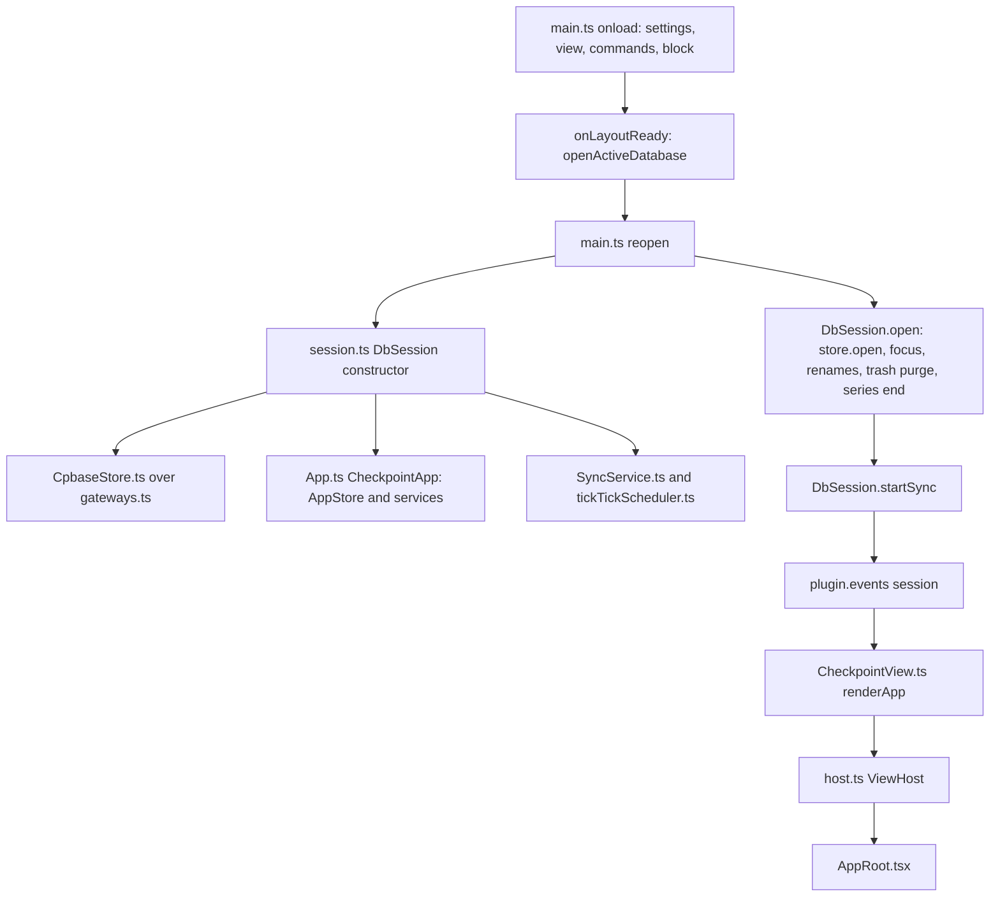
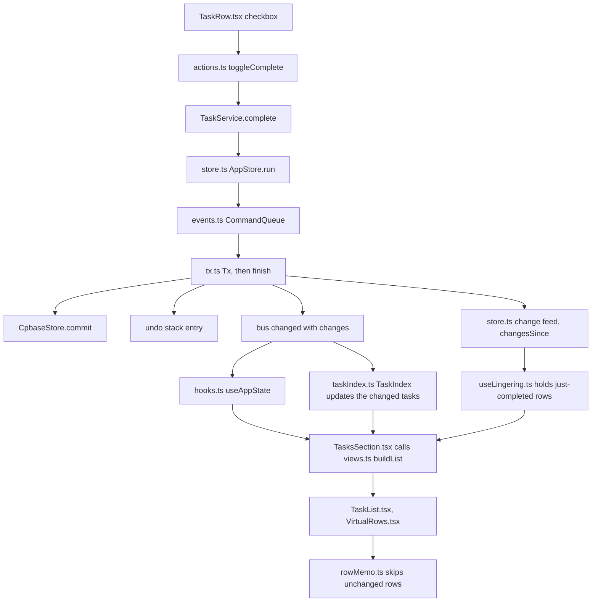
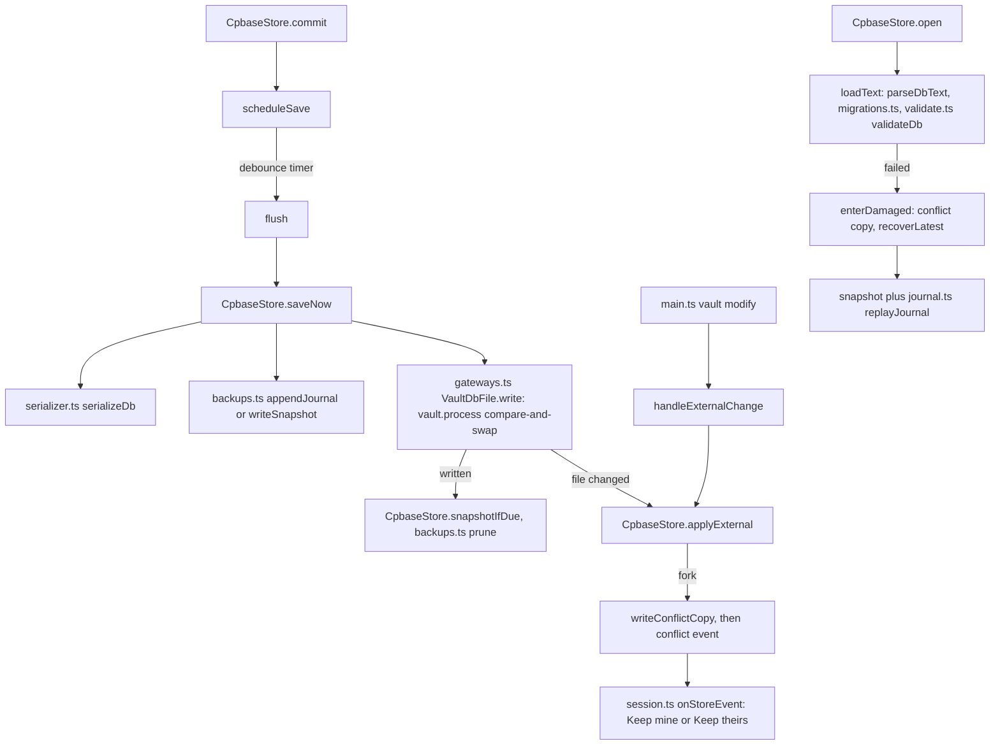
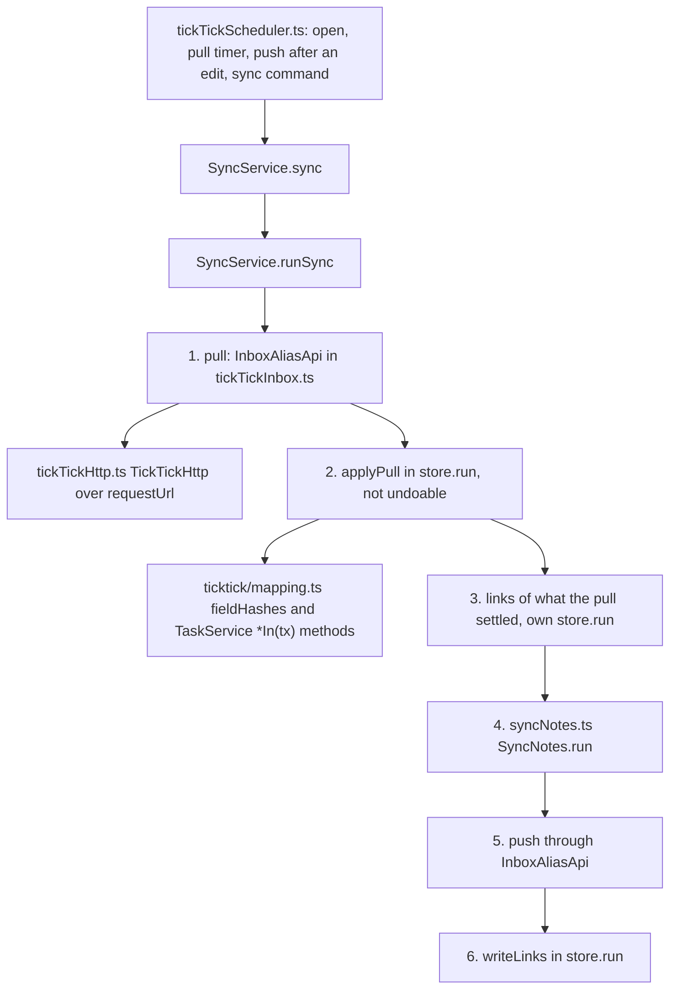

# Architecture

This page explains what each layer is for and how a change travels from a click to the file and back to every view. What the product does, feature by feature, is in the product spec. Code identifiers keep the name Checkpoint; the manifest id is `logwell`.

## Overview

Logwell is a desktop Obsidian plugin for tasks, lists, a calendar, an Eisenhower matrix, a focus timer, habits and repeating tasks. A database is one `.cpbase` JSON file in the vault, shown in one Logwell tab.

The code has six layers. Dependencies point down: `src/obsidian` uses `src/ui` and `src/app`; `src/ui` uses `src/app` and the persistence types; `src/app` uses `src/persistence`, which uses `src/domain`. Only `src/obsidian` and `src/main.ts` import `obsidian`; the lint rules in `eslint.config.mjs` enforce the layers.

- `src/domain`: the product rules as pure functions and types. It has no clock and no I/O: the current time and day come in as arguments. It imports nothing above it (one type comes from `src/parsing`).
- `src/parsing`: the Quick Add parser and the task block parser. Pure, like `src/domain`, and it imports only `src/domain`.
- `src/persistence`: the file format, loading, saving, backups and recovery. It reaches files through the ports in `src/persistence/gateway.ts`, never through Obsidian.
- `src/app`: the services that change data, the command queue, Undo and the read selectors. It reaches Obsidian through the ports in `src/app/ports.ts`.
- `src/obsidian`: the adapters that implement those ports, the view, modals, settings, notices and the TickTick client.
- `src/ui`: the components (TSX). They reach Obsidian only through `UiHost` (`src/ui/host.ts`) and never write storage.

## Start-up and session

The plugin opens one database at a time, the one named by the **Active database** setting. A `DbSession` (`src/obsidian/session.ts`) owns it: it wires the store to the vault, builds the app services and maps store events to notices. Opens are queued (`queueOpen` in `src/main.ts`).



`CheckpointApp` (`src/app/App.ts`) is the composition root of the app layer: one `AppStore` and every service, plus `queryContext()`, the context every view reads. A view whose file is not the active database shows **Make active** instead of the app.

Closing a session stops the TickTick sync, lets a focus write finish, applies the note renames still queued and closes the store, which saves what is pending. A database switch first waits for a TickTick request in flight, at most `SYNC_CLOSE_WAIT_MS` (`DbSession.settleSync`); plugin unload does not wait, so closing stays synchronous there.

## A change

Every write is one command: one call to `AppStore.run` in `src/app/store.ts`. A command saves once and undoes in one step, however many records it touches. The view calls a helper such as `toggleComplete` in `src/ui/actions.ts`, or a service method directly, and the service runs `store.run(label, tx => ...)`.



The `CommandQueue` (`src/app/events.ts`) runs one command at a time, in order. A read-only store refuses the command with `DomainError("ReadOnly")`. The command reads and writes through a `Tx` (`src/app/tx.ts`), a copy-on-write view of the state. `Tx.finish` keeps only records whose value differs (Data and safety rule 3).

Records are immutable: a change is a fresh object, and only the collections a command touched get a fresh map. Views and the serializer rely on that identity. `CpbaseStore.commit` swaps the state in memory at once and schedules the save, so views never wait for the file.

The store then emits `changed` (declared as `AppEvents` in `src/app/store.ts`, sent on the `EventBus` from `src/app/events.ts`). It carries the label and the change list: each record written, before and after. A reload or a full replace carries no list, which means anything may differ.

Listeners use the list to narrow their work: the task index (`src/app/taskIndex.ts`), the task block (`src/obsidian/dashboardBlock.ts`) and the TickTick scheduler.

The store also keeps the change lists of the last 64 `changed` events and counts the events (`AppStore.version`). `changesSince(version)` returns every change written since that count, oldest first, the records themselves; it returns nothing (`undefined`), never part of the list, when a reload or a replacement came in between or the count is older than the last 64 events. A view that renders after several changes reads them from there: `useLingering` (`src/ui/useLingering.ts`) holds a task for its check animation when a change since its last render took it from open to completed, and releases one reopened, without a pass over every task. When the store cannot list the changes it holds nothing new (a task completed by a reload does not animate) and only releases held tasks that are open again. A hidden section looks at nothing; when shown again it starts from the current count.

The task index (`TaskIndex`, built in `TaskService` and reached as `app.tasks.lists`) holds which tasks can be in each Tasks view: the tasks of each list, the dated tasks (a schedule, a deadline or a repeat rule) for Today and Upcoming, the tasks of each tag, the completed tasks, the open counts of lists and tags, and the subtask counts of every parent. It also keeps each list's tasks in sort order, built the first time the Inbox or a list is read and moved by a binary search after that (an order that one event moves more than 64 places of is dropped and sorted again on the next read), so the Inbox and list rows come out of `candidates` already in order and `arrangeHierarchy` does not sort them. For each task in the change list it takes the record out as it was and puts it in as it is. A `changed` without a list drops it, and the next read builds it again in one pass. It is current while the store's task map is the one it describes, so a save (a new state with the same task map) keeps it. A `changed` whose command started from another task map (its `base`), or replaced a record other than the one the index holds, drops it too (a write that skipped the store); so does a read that finds another task map. `buildList` and `buildBoard` filter only the view's candidates from it, and `sidebarCounts` reads its counts and counts Today and Upcoming over the dated tasks. The subtask counts (`subtaskCounts()`, read by `useSubtaskCounts` in `src/ui/hooks.ts`) never change once handed out: a change that moves a parent's count gives a new map in which only that parent has a new count object, so rows, which compare counts by value, and memos keyed on the map redraw only for that parent. Without an index both read every task: that path is the reference the index is tested against (`tests/app/issue-41-task-index.test.ts`). The candidates may hold extra tasks, never fewer: each view still applies its full test. The TickTick sync reads a linked list's tasks and the 999 open-task cap from the same index.

`useAppState` (`src/ui/hooks.ts`) ignores the list and re-renders the app on every `changed` and `status` event. `TasksSection.tsx` calls the selectors in `src/app/views.ts` only when the collections they read changed, and `rowMemo.ts` skips every row whose inputs are the same.

`AppStore.undo` pops the newest entry of the undo stack and restores the `before` values; `DomainError("UndoConflict")` is the refusal of Data and safety rule 17. A read-only store refuses before taking the entry, so it stays; a conflict drops it. Each entry has an increasing id, and a notice undoes its own entry by that id.

Services return a `WriteResult` (`src/app/writes.ts`) with the command's label. A caller takes `store.undoMark()` right before the write; `notifyWrite` (`src/ui/writeNotice.ts`) hands the result and the mark to `ViewHost.notifyUndo` (`src/obsidian/host.ts`), which binds its Undo button with `undoFor(mark, label)` to the one entry pushed under that label since the mark (writes under other labels in between do not count; none or two or more bind nothing, and the button refuses). The button reverts that entry only while it is the newest, checked inside the command queue.

Maintenance writes pass `{ undoable: false }`. The depth of Undo and what it covers are in the Data and safety section of the spec.

## Saving, backups and recovery

`CpbaseStore` (`src/persistence/CpbaseStore.ts`) debounces the save, journals it, then writes the file with a compare-and-swap, so it never overwrites a version it has not seen. Its own write queue keeps saves, outside changes and restores apart.



On open, `loadText` parses the file, runs the steps in `src/persistence/migrations.ts` and validates every record with `validateDb` (`src/persistence/validate.ts`), which also repairs broken references. What happens to a migrated or repaired file is Data and safety rule 13.

A save writes a journal entry (`src/persistence/journal.ts`) to the plugin's backup folder, then writes the database text through `VaultDbFile` in `src/obsidian/gateways.ts`. Its `vault.process` callback checks that the file still holds a revision this device read or wrote. If not, the store treats the text as an outside change (Data and safety rule 5).

`applyExternal` handles both a vault `modify` event and a failed compare-and-swap, and decides between ignore, reload and conflict copy by Data and safety rules 6 to 8; the session turns a conflict into the **Keep mine** and **Keep theirs** notice.

The store has two read-only states (`ReadOnlyState`): "damaged", in which `recoverLatest` shows the newest valid snapshot plus the journal, and "newer-schema". What each allows is Data and safety rules 14 and 15.

`AppStore.run` refuses commands in both states, and the UI shows `ReadOnlyBanner` (`src/ui/Banners.tsx`). The rules, the snapshot kinds, when each is taken and how many are kept are in the Data and safety section of the spec.

## The TickTick sync cycle

The session builds one `SyncService` (`src/app/SyncService.ts`) and one `TickTickScheduler` (`src/obsidian/tickTickScheduler.ts`). The scheduler decides when to sync; the engine decides what to change on each side.



The scheduler listens to `changed` and arms a delayed push only for edits that touch a linked list; the sync's own labels (`SYNC_OWN_LABELS`) never trigger one. How runs queue is TickTick sync rule 18.

A sync pulls every linked list, then writes everything pulled as one command that is not undoable. Each field compares as a hash from `src/domain/ticktick/mapping.ts` against the base stored in the `syncLinks` collection, so the engine knows which side changed.

The engine writes tasks through the `*In(tx, ...)` methods of `TaskService` and `SectionService`, so a pulled change obeys the same rules as an edit by hand. The pull command writes no links. A separate links command then links what the pull settled, before any push, so a failed push or a reload does not import them again.

Description notes run next (`src/app/syncNotes.ts`), then the push sends what differs, list by list. Last, `writeLinks` saves what TickTick confirmed, as its own command, even after a failed push. The timings and behavior rules are in the TickTick sync section of the spec.

## UI structure

`CheckpointView` (`src/obsidian/CheckpointView.ts`) draws one component tree under `AppRoot`.

- Shell: `src/ui/AppRoot.tsx` draws the rail and one panel per section (Tasks, Calendar, Focus, Habits, Matrix, Search, Data). `SectionId` is in `src/ui/host.ts`.
- Hidden sections: every section stays mounted and hidden when inactive, so it keeps its state. Heavy work waits until it is visible (`useActiveMemo` in `src/ui/hooks.ts`). `SectionRelay` (`src/ui/sectionRelay.ts`) delivers "show this section" from commands.
- Sections: one `<Name>Section.tsx` each, such as `src/ui/TasksSection.tsx`, with parts in folders (`src/ui/board/`, `calendar/`, `focus/`, `habits/`, `matrix/`, `quickadd/`). The Tasks section adds `Sidebar.tsx`, `TaskDetails.tsx` and `CompletedGroup.tsx`.
- Views: pure selectors build what a section shows: `buildList` (a view's open rows and its Completed group from one filtering of the view's candidate tasks from the task index), `buildBoard` and `globalSearch` in `src/app/views.ts`, over the rules in `src/domain/queries.ts`, which holds the shared date rules (`scheduleOf`, `matchesTaskDate`, `isOverdue`).
- Rows: `src/ui/TaskList.tsx` and `src/ui/TaskRow.tsx` are the one row component, used by the Tasks, Calendar, Matrix and Search sections and by the task block (`src/ui/DashboardBlock.tsx`). `TaskRow` and `board/BoardCard.tsx` are wrapped in `memoComponent` (`src/ui/rowMemo.ts`); a row that reads something extra must add it to its comparator.
- Windowing: `src/ui/VirtualRows.tsx` draws a list or board column in full up to `VIRTUAL_THRESHOLD` rows (`src/ui/virtual.ts`). Above it, only rows near the viewport are drawn, plus the focused or dragged row. Code that needs an undrawn row goes through `virtualHandle(box)`.
- Writes: shared helpers call the services and show the notice: `src/ui/actions.ts`, `repeatActions.ts`, `sectionActions.ts`, `habits/actions.ts`. Errors go to `host.error(err)`.
- Drag: `src/ui/drag.ts` is the one pointer gesture for lists, board, matrix and calendar. A drop ends in one service call, so it is one undo step.
- Styles: one `styles.css` at the repository root, with `--cp-*` tokens on `.cp-theme` derived from Obsidian's theme variables.

## Testing

All but e2e run in `npm test`.

- Unit and integration (`tests/domain`, `tests/parsing`, `tests/persistence`, `tests/app`, `tests/obsidian`, `tests/ui`): pure rules, the parser, the store, the services on a real store, the host classes over a fake vault and the components in a simulated DOM.
- Harnesses: `harness()` in `tests/persistence/fixtures.ts`, `appHarness()` in `tests/app/harness.ts`, `U1Host` in `tests/ui/u1-helpers.tsx`, and `tests/app/sync-harness.ts` over a fake TickTick.
- Schema fixtures: `tests/fixtures/schema-v*.cpbase` are frozen sample files that the migration tests load; a schema change adds one and never edits an old one.
- Perf (`tests/perf`, plus `tests/ui/perf-*.test.tsx`): time budgets at large counts through the real code, and render-pass counts that guard row memoization and windowing.
- Limits: `e2e/limits/` measures open, save and render times in real Obsidian, one size step at a time. It runs locally and outside `npm run e2e`; see [performance.md](performance.md). `tests/limits/limits.test.ts` checks its generator and CSV helpers.
- End to end (`e2e/specs/*.e2e.ts`): the plugin bundle in a sandboxed, pinned Obsidian against a copy of `test-vault/`. `freshDatabase()` in `e2e/helpers.ts` resets the vault before each test.

Commands:

```
npm run typecheck   # the source and the e2e project
npm run lint
npm test
npm run e2e         # builds first; local only
```

## Where to start for common changes

| Change | Files to open |
| --- | --- |
| A task field | `src/domain/types.ts`, `src/persistence/schema.ts` (key order, default), `src/persistence/validate.ts`, `src/app/TaskService.ts` (`TaskInput`, `TaskPatch`), `src/ui/TaskDetails.tsx` |
| The file format | `src/persistence/schema.ts` (`CURRENT_SCHEMA_VERSION`), `migrations.ts`, `validate.ts`, `holdsDataNewerThan` in `CpbaseStore.ts`, a frozen fixture in `tests/fixtures/` |
| A service command | the matching `src/app/*Service.ts`: `store.run` with an exported label, returning `WriteResult` when the UI offers Undo |
| A setting | `src/app/settings.ts` (`DEFAULT_SETTINGS`, `sanitizeSettings`), `getSettingDefinitions()` in `src/obsidian/SettingTab.ts`, `SettingsPort` in `src/app/ports.ts` if a service reads it |
| A command | `registerCommands()` in `src/main.ts` |
| A Tasks view rule | `src/domain/queries.ts`, `src/app/views.ts`, `src/ui/TasksSection.tsx` |
| A rail section | `SectionId` in `src/ui/host.ts`, `SECTIONS` in `src/ui/AppRoot.tsx`, a `<Name>Section.tsx` (mockup first) |
| A Quick Add token | `src/parsing/tokens.ts`, `parse.ts`, `src/ui/quickadd/QuickAddModel.ts` |
| A task block filter | `src/parsing/blockQuery.ts`, `compileBlockQuery` in `src/domain/blockQuery.ts`, `src/app/blockView.ts` |
| A synced field | `src/domain/ticktick/mapping.ts`, `src/app/SyncService.ts` |
| Device-local state | a port in `src/app/ports.ts`, a local storage class in `src/obsidian/`, wired in `src/obsidian/session.ts` |

## Glossary

- Command: one write through `store.run`, saved once and undone as a whole.
- Label: the name a command runs under, shown in its Undo notice and used by `undoFor` to find the write a notice was shown for.
- Store: `AppStore` (`src/app/store.ts`) for state, queue and Undo, over `CpbaseStore` (`src/persistence/CpbaseStore.ts`) for the file.
- Session: a `DbSession`, the one open database with its store, services and sync.
- Tx: the copy-on-write transaction a command reads and writes through.
- Change list: the `changes` on a `changed` event, each record a command or an undo wrote, before and after.
- Port: an interface a lower layer declares and `src/obsidian` implements, such as `NotePort` or `DbFile`.
- UiHost: the only door from components to Obsidian, implemented by `ViewHost` in `src/obsidian/host.ts`.
- Query context: the day, zone, week start and schedule reader a view reads, from `CheckpointApp.queryContext()`.
- Schedule resolver: the memoized reader of when a task is due (`scheduleResolver` in `src/domain/recurrence.ts`), used through `scheduleOf`.
- Occurrence: one date of a repeating task; its completed or skipped state is an `OccurrenceRecord`.
- List entry: a task placed in a view with its depth and resolved schedule (`ListEntry` in `src/domain/queries.ts`).
- Lingering: the short hold that keeps a just-completed row in place for its animation (`src/ui/useLingering.ts`).
- Windowing: drawing only the rows near the viewport in a long list (`src/ui/VirtualRows.tsx`).
- Revision: the id each save writes in the file header, with the last 50 in `history`.
- Compare-and-swap: a write that goes ahead only if the file still holds the revision this device expects.
- Journal: the changes since the newest snapshot (`journal.ndjson`), replayed only in recovery.
- Snapshot: a full copy of the database in the plugin's backup folder, taken on a schedule or before a risky action.
- Conflict copy: a version that lost a fork or could not be read, kept under `conflicts/` for the user to choose.
- Read-only state: "damaged" or "newer-schema", in which the store refuses every command.
- Sync link: a record in `syncLinks` that pairs a Logwell list, section or task with its TickTick copy and holds the field hashes.
- Link mode: how a linked task takes part in the sync: `sync`, `excluded` while either copy repeats, or `localOnly` after Keep.
- Device-local state: data kept in the vault's local storage per device and database, never in the file.
