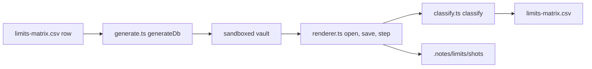

# Performance limits

Logwell must stay fast at 50,000 tasks. The limits harness finds how far each kind of data can grow in real Obsidian before the plugin slows or breaks. The unit perf tests guard the paths that scale with the task count on every test run.

Logwell's one enforced cap is on lists synced with TickTick: an add past 999 open tasks is refused. Any other cap would be based on these numbers. Rerun both checks after any change to a path that scales with the number of tasks.

## Method

The harness grows one dimension at a time and keeps everything else at the baseline: 500 tasks, 10 lists, 20 tags, 5 habits and 200 focus records. The matrix has 13 dimensions of 5 steps each, such as `tasks_total` from 1,000 to 50,000.

For each row of [`tests/limits/limits-matrix.csv`](../../tests/limits/limits-matrix.csv), the harness:

1. Builds a valid, deterministic database with that count through the project's own serializer (`e2e/limits/generate.ts`).
2. Resets the sandboxed vault (a copy of `test-vault/`), writes the database into it and sets a 1400 by 900 window.
3. Measures three times inside the Obsidian window (`e2e/limits/renderer.ts`), so WebDriver round trips never count. Each clock stops two animation frames after the view appears, so layout and paint are included, with a floor of about 17 to 33 ms.
4. Classifies the row (`e2e/limits/classify.ts`) and writes it back into the CSV at once, so an interrupted run keeps what it has.

| Column | What it holds |
| --- | --- |
| `db_size_kb` | The size of the generated database file. |
| `open_ms` | From `setActiveDatabase` to the first rendered Today view. |
| `save_ms` | Completing one task until the store is no longer dirty, so the write reached the file. The next two saves go into `notes`. |
| `render_ms` | The slowest counted view switch in `views_to_check`. |
| `ui_ok` | `yes` or `no`, filled in by hand from the screenshots. |
| `result` | `pass`, `slow`, `broke` or `skipped`. |
| `notes`, `version`, `device`, `date` | Context: data summary, per-view times, manifest version plus `+main`, machine, day. |

Once a dimension breaks, the harness skips its larger steps. Screenshots go to `.notes/limits/shots/` and CPU profiles to `.notes/limits/profiles/`, both gitignored.

## Budgets

| Time | Pass | Slow | Broke |
| --- | --- | --- | --- |
| `open_ms` | under 1,000 ms | 1,000 to 3,000 ms | over 3,000 ms |
| `save_ms` | under 200 ms | 200 to 600 ms | over 600 ms |
| `render_ms` | under 300 ms | 300 to 900 ms | over 900 ms |

A row passes when all three times pass. It is broke when any time is over three times its limit, or on an error, a freeze or the 60 s budget of a row. A row with `ui_ok` set to `no` (something overflows, overlaps, is cut off or unreachable) is also broke, but `classify` cannot see that: change its `result` by hand.

The limit of a dimension is its last `pass` step, rounded down. Between the last `pass` and the first `broke`, Logwell would warn instead of refusing.

## What the unit perf tests cover

These run in `npm test`, in Node or happy-dom, not in Obsidian. With `CI` set, each budget is four times larger. `CHECKPOINT_PERF_LOG=1` prints the measured times.

| Test | What it checks |
| --- | --- |
| `tests/perf/persistence.test.ts` | Load under 500 ms and one saved edit under 100 ms at 5,000 tasks, 20,000 check-ins and 5,000 focus sessions. |
| `tests/perf/recurrence.test.ts` | Today, Upcoming and the sidebar counts under 100 ms, a calendar month under 250 ms, with 500 of 5,000 tasks repeating; growth is linear. |
| `tests/perf/habits.test.ts` | Habit index and streaks of 20 habits over 20,000 check-ins under 25 ms. |
| `tests/perf/issue-4-dashboard-block.test.ts` | Ten task blocks over 50,000 tasks: one change wakes only the blocks it can affect, within 50 ms. |
| `tests/perf/issue-16-search-notes.test.ts` | Search with "Also search description notes" on, 50,000 tasks of which 5,000 link a note: 20 commits that change no note link read no note, and finding the linked notes takes one pass under 25 ms (about 4 ms here). |
| `tests/perf/issue-35-backup-listing.test.ts` | Measures the backup retention pass after a save. 50 saves with no snapshot due list the snapshots folder 50 times (1 per save). One retention pass over a folder at its limits (50 snapshots) takes about 0.11 ms of CPU in memory; a disk listing with one stat per file takes about 0.21 ms. Bounded loosely, not a budget. |
| `tests/perf/issue-36-save-sort.test.ts` | Measures the id sort inside a save at 50,000 tasks. Serializing after a one-task edit takes about 9 ms when the task map is in file order (as after opening), of which the id sort is about 1 ms; with ids inserted in random order (worst case) it takes about 21 ms, of which the sort is about 11 ms. A save through the store takes about 14 ms. One edit builds one new record line. Bounded loosely by the 200 ms `save_ms` limit, not a budget. |
| `tests/perf/issue-41-tasks-view-edit.test.ts` | Measures one task edit with the Tasks view open at 50,000 tasks. `buildView` after the edit takes about 8 ms for the Inbox (25,000 rows), 3.6 ms for Today and 4 ms for a list; the sidebar counts take about 2 ms. The edit command makes 1 full pass over the task map, and the section's redraw makes 5 (the view, its Completed group, the sidebar counts, the lingering rows and the subtask counts). The redraw takes about 30 ms (Inbox) and 18 ms (Today) in happy-dom. Bounded loosely, not a budget. |
| `tests/perf/issue-6-sync.test.ts` | A TickTick sync of 9 lists of 999 tasks within budget, reading only linked tasks of 50,000. |
| `tests/perf/issue-6-ticktick-mapping.test.ts` | The TickTick field mapping of 50,000 tasks under 200 ms. |
| `tests/ui/performance.test.tsx` | The Inbox at 5,000 tasks: a constant number of task map scans, query under 25 ms, render under 500 ms. |
| `tests/ui/perf-renders.test.tsx`, `perf-renders-lingering.test.tsx`, `issue-6-perf-renders.test.tsx` | One change renders the Tasks section once and redraws only the rows whose inputs changed. |
| `tests/ui/perf-virtual-list.test.tsx`, `perf-virtual-board.test.tsx`, `perf-virtual-app.test.tsx` | Above 150 rows (`VIRTUAL_THRESHOLD` in `src/ui/virtual.ts`), lists and board columns draw only the rows near the viewport. |
| `tests/ui/perf-layout-reads.test.tsx` | Quick Add reads its input's scroll position only when its own text changes. |

`tests/limits/limits.test.ts` checks the harness itself: the matrix shape, the CSV round trip, the generated databases and `classify`.

## Run the checks

Use a quiet machine, one run at a time, and keep the mouse off the Obsidian window. The `device` column is read with `sysctl`; where that is missing it reads `unknown CPU`.

1. Keep the latest run: `mkdir -p docs/development/performance/results/<YYYY-MM-DD>-<label>`, then copy `tests/limits/limits-matrix.csv` into it. The harness overwrites that file.
2. Run the unit perf tests: `npx vitest run tests/perf tests/ui/perf- tests/ui/issue-6-perf-renders tests/ui/performance.test.tsx tests/limits`.
3. Build the release bundle and run the matrix:
   `npm run build && npx wdio run ./wdio.conf.mts --spec ./e2e/limits/limits.e2e.ts`.
   The harness is not part of `npm run e2e`. To run part of it, set `LIMITS_MAX_STEP` (the highest step, default 5) or `LIMITS_ONLY` (a comma list of dimensions).
4. Read the summary the run prints, and open the screenshots in `.notes/limits/shots/`: `<dimension>-<step>.png` is each row's slowest view.
5. Set `ui_ok` to `yes` or `no` for every measured row in the CSV. The harness keeps whatever `ui_ok` held before, so check every row. Change `result` to `broke` where `ui_ok` is `no`.
6. Compare with the run you archived in step 1: `git diff --no-index --word-diff docs/development/performance/results/<YYYY-MM-DD>-<label>/limits-matrix.csv tests/limits/limits-matrix.csv`. The CSV writer keeps the quoting, so the diff shows only measured cells. A single row that moves while its neighbours do not is noise: rerun it with `LIMITS_ONLY`.
7. To see where the time goes at 50,000 tasks, profile with the unminified build:
   1. `LOGWELL_PROFILE_BUILD=1 node esbuild.config.mjs production` writes an unminified `main.js` and `main.js.map`.
   2. `npx wdio run ./wdio.conf.mts --spec ./e2e/limits/profile.e2e.ts` writes CPU profiles of open, save and view switches to `.notes/limits/profiles/`. `PROFILE_TASKS` sets the size.
   3. `npx tsx e2e/limits/profile-report.ts` prints the tables, naming functions by `src/` file and line, and writes them to `.notes/limits/profiles/report.txt`.
   4. `npm run build` puts the minified bundle back.
8. Update the latest results below and add a line for the archived run under older runs.

## Latest results

[`tests/limits/limits-matrix.csv`](../../tests/limits/limits-matrix.csv) holds the latest run, and `tests/limits/limits.test.ts` reads it. Run of 2026-10-08 (machine in the `device` column), TickTick sync off: all 65 rows pass and the UI holds at every size.

| Dimension | Largest step | File KB | Open | Save | Render |
| --- | ---: | ---: | ---: | ---: | ---: |
| `tasks_total` | 50,000 | 16,133 | 503 | 156 | 52 |
| `tasks_in_one_list` | 5,000 | 2,103 | 74 | 21 | 28 |
| `repeating_tasks` | 5,000 | 3,725 | 112 | 32 | 287 |
| `calendar_month` | 2,000 | 1,033 | 51 | 14 | 82 |
| `checkins` | 100,000 | 20,292 | 342 | 81 | 16 |
| `focus_sessions` | 50,000 | 21,751 | 677 | 83 | 15 |

Times are in ms. The other seven dimensions pass with every time under 110 ms.

Findings:

- No dimension broke, so every limit, 50,000 tasks included, lies above the measured range. `tasks_total` has the highest save time (156 ms) and the second-highest open time, after `focus_sessions`. Saving rewrites the whole file, so `save_ms` grows with the task count.
- Repeating tasks are the slowest dimension: 5,000 of them render in about 290 ms, on the 300 ms limit. Noise moves it between `pass` and `slow`.
- File size alone is not the bottleneck: 100,000 check-ins (20 MB) open in 342 ms.
- The harness has no rows for task blocks or a running sync; the unit perf tests cover them.

## Older runs

| Run | What changed | Pass / slow / broke | 50,000 tasks: open / save / render (ms) |
| --- | --- | --- | --- |
| Baseline | First run. | 59 / 5 / 1 | 2,380 / 1,566 / 1,513, broke |
| Release A | Cached date math, one render pass per change, memoized rows. | 61 / 3 / 1 | 1,344 / 236 / 1,057, broke |
| Release B | Windowed lists and board columns above 150 rows. | 64 / 1 / 0 | 516 / 167 / 54, pass |
| Release C | Task blocks in notes; a regression check. | 65 / 0 / 0 | 500 / 156 / 55, pass |
