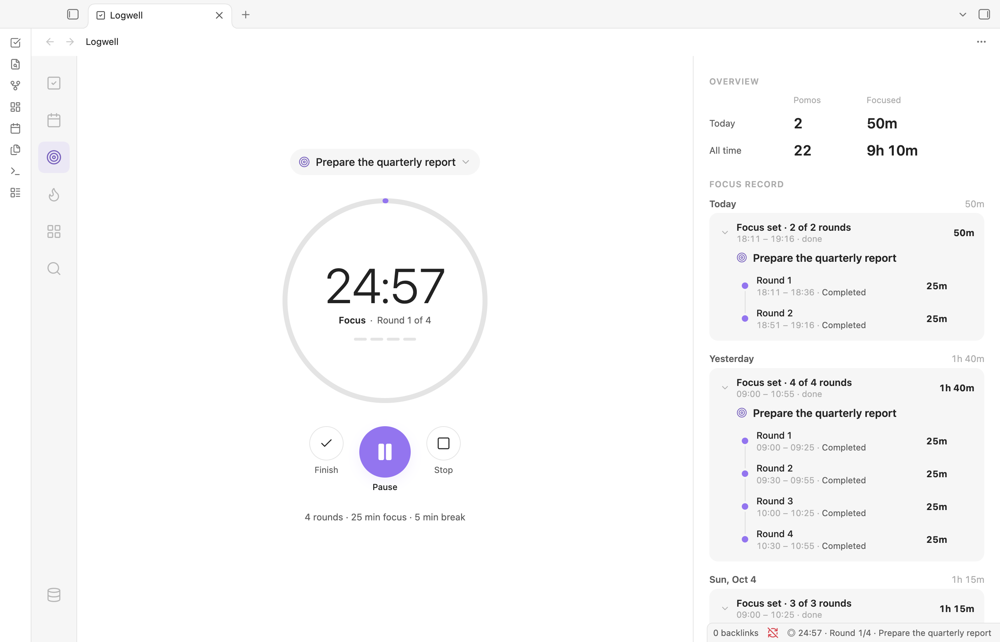
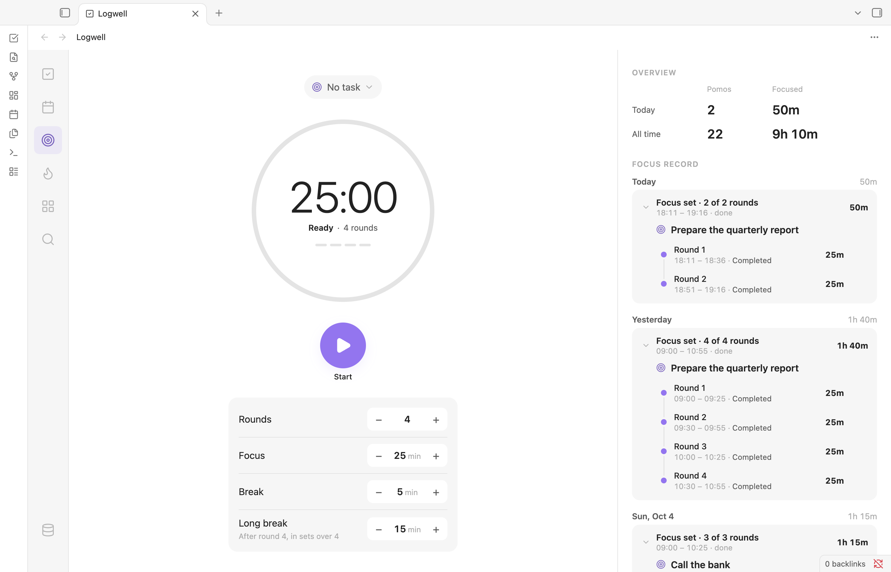

# Focus

Focus helps you work in timed rounds with short breaks in between. You start a focus set, and Logwell runs the rounds and breaks for you and records every round, on a task or on none. Open the page with **Focus** in the rail or with the command **Open focus**. Your saved rounds and what to do after a crash are on [Focus record](focus-record.md).

<picture>
  <source media="(prefers-color-scheme: dark)" srcset="images/focus-dark.png">
  
</picture>

## Start a focus set

<picture>
  <source media="(prefers-color-scheme: dark)" srcset="images/focus-start-dark.png">
  
</picture>

A set is a number of focus rounds, with a break after each one except the last. Before you start, set its length with the minus and plus buttons under the timer:

| Setting | What it does | Default |
| --- | --- | --- |
| Rounds | The number of focus rounds, from 1 to 8. | 4 |
| Focus | The length of a focus round, from 1 to 180 minutes. | 25 |
| Break | The length of a short break, from 1 to 60 minutes. | 5 |
| Long break | The break after round 4, used only in sets of more than four rounds. From 1 to 60 minutes. | 15 |

Logwell remembers these values for your next set. Click **Start**.

The set then runs by itself: each break and each next round starts on its own. After the last round the page shows a summary such as "4 rounds · 1h 40m focused", and **Start again** begins a new set with the same values.

Only one timer runs at a time. If you start focus on the task that already runs, Logwell says "A focus timer is running" and offers **Go to running timer**.

## Control a running set

| Button | When | What it does |
| --- | --- | --- |
| **Pause** and **Resume** | Any time in a set | Stop and restart the clock. Paused time is not counted. |
| **Finish** | In a focus round | Ends the round at once as completed, with the time you focused, and moves on to the break or ends the set. |
| **Skip break** | In a break | Ends the break and starts the next round. |
| **Stop** | Any time in a set | Ends the whole set. A focus round in progress is saved as stopped. |

The commands **Pause or resume focus** and **Stop focus** do the same from anywhere. See [Settings and commands](settings-and-commands.md).

Finishing a round never completes the task. Complete it yourself when the work is done.

### Rounds under a minute

By default, a round that you end with **Stop** or **Finish** after less than a minute is not saved. A notice says "Focus under a minute was not saved" and has **Undo**, which saves it after all. **Finish** on the last round of a set is kept when the set already has a saved round. To save every round, turn off **Skip focus rounds under a minute** in the settings.

## Focus on a task

A set can have a task, or none. Choose it in the **Focus on** box above the timer, or start focus from the task itself:

- the **Focus** button at the bottom of the task's details,
- **Start focus** in the task's row menu,
- the command **Start focus on selected task**, which needs a selected task and otherwise says "Select a task first."

Each saved round counts toward its task. The task's rows and details show the time focused. Time on a subtask counts toward the subtask only.

### Change the task during a round

Pick another task in the **Focus on** box, or start focus on another task. During a focus round, Logwell asks under "Change the focus task":

- **Split** saves the time so far on the current task and continues the round on the other one, with the time that is left.
- **Reassign** moves the whole round to the other task.
- **Cancel** changes nothing.

In a break, Logwell does not ask: the task you pick is the task of the next round.

## Follow the timer in the status bar

On desktop, the status bar shows the running timer, for example "◎ 18:42 · Round 2/4 · Pay rent". In a break it adds "Short break" or "Long break", and a paused timer adds "(paused)". Click it, or press Enter or Space on it, to open the Focus page. It is hidden when no set runs.

## Hear and see when a phase ends

Logwell plays a short sound when a focus round starts, when a break starts and when a set ends. When a break starts, a notice says that the focus is done and it is time for a break. When a set ends, a notice starts with "Focus set done" and gives the rounds and the time.

When Obsidian is in the background, Logwell also sends a system notification if you allowed it. It asks for that permission once, the first time you start a set.

Choose the sound with **Sound theme** and **Sound volume**, and hear it with **Play**. See [Settings and commands](settings-and-commands.md).
