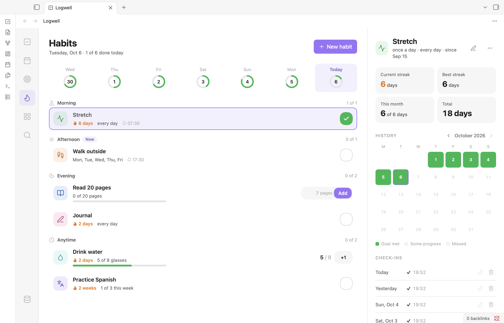
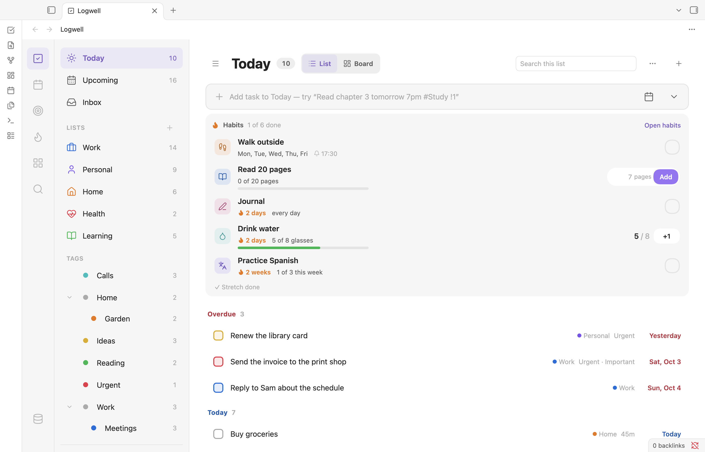

# Habits

Habits are things you do again and again, such as reading every evening or going to the gym three times a week. Logwell counts them, shows your streaks and can remind you. Habits never appear in your task lists or counts.

Open the page with **Habits** in the rail or the **Open habits** command.

<picture>
  <source media="(prefers-color-scheme: dark)" srcset="images/habits-dark.png">
  
</picture>

## Create a habit

Choose **New habit**. While you have no habits, the page also offers examples, such as **Read 30 min a day**. An example only fills in the form; nothing is saved until you choose **Create habit**. The form has these parts:

- **Name** and **Color**. The button next to the name, **Choose icon**, opens the icon picker.
- **How do you track it?**
  - **Done or not**: something you do or skip, like meditating.
  - **Count**: a whole number, like 8 glasses. The unit is optional.
  - **Amount**: a number that can have decimals, like 30 min or 5 km. It needs a unit of up to 12 characters.
- **Goal**: the target, the unit and whether it is per day or per week. A done-or-not habit has a goal only under **Times a week**, where it is the number of days, from 1 to 7.
- **When**: **Every day**, **Some days** (you pick the weekdays) or **Times a week** (any days, with a goal per week).
- **Time of day**: **Morning**, **Afternoon**, **Evening** or **Anytime**.
- **Reminder**: the **Remind me** switch and a time. See [Habit reminders](habit-reminders.md).

## Change a habit

Select the habit and choose **Edit habit**, then **Save**.

A change to the goal or to **When** applies from today, or from the start of this week for a goal per week. Past days keep the goal they had, so your history and streaks stay as they were. Other changes apply to the whole habit.

## Check in

The control on each row depends on how you track the habit:

- **Done or not**: a round check button. Click it again to remove the check-in.
- **Count**: the progress, such as "5 / 8", and a **+1** button.
- **Amount**: a number field with the unit, and **Add**. Press Enter or choose **Add**. Use a point or a comma for decimals, up to six. A value such as "10,000" is refused, because it could mean ten thousand or ten.

Every check-in shows a notice with **Undo**. You cannot check in for a future day or for a day before the habit began.

## Read the Habits page

The line under the title sums up the day, such as "Tuesday, Oct 6 · 1 of 4 done today". The week strip shows the seven days ending today, each with a ring for the share of habits you met.

**Groups.** Habits are listed under Morning, Afternoon, Evening and Anytime, each with "n of m" done. A **Now** badge marks the group for the current time. Evening starts at the **Evening time** setting (see [Settings and commands](settings-and-commands.md#time)).

**Rows.** Each row shows the name, the current streak, the progress (such as "20 of 30 min"), the reminder time and a progress bar for counts and amounts. On a day the habit is not scheduled, the row reads "Not scheduled today".

## Fill in a day you missed

Choose a past day in the week strip. The page shows that day, and your check-ins go to it. Choose **Today**, or the same day again, to come back.

## See a habit's history

Select a habit to see its detail beside the list:

- The goal and schedule in words, such as "30 min a day · every day · since Sep 8".
- Four tiles: **Current streak**, **Best streak**, **This month** and **Total**.
- **History**: a month calendar with **Previous month** and **Next month**. Days are marked **Goal met**, **Some progress** or **Missed**; unscheduled days stay plain.
- **Check-ins**: newest first, with the amount and the time, or "added later" for a day you filled in. Use **Edit check-in** to change an amount and **Delete check-in** to remove one. **Show more** loads older ones.

### How streaks count

For a goal per day, the current streak counts the days in a row on which you met the goal. Unscheduled days are skipped, so a weekday habit runs from Friday to Monday. Today never breaks the streak; it counts once you meet it. For a goal per week, the streak counts weeks. The best streak is the longest run.

## Archive or delete a habit

Open **More: archive, delete** in the habit's detail.

- **Archive** hides the habit from Today, the week strip, the groups and reminders, and keeps its history. Find it under **Archived habits** at the bottom of the page, and choose **Restore** to bring it back. You cannot change the check-ins of an archived habit.
- **Delete habit…** removes the habit and all its check-ins. Logwell asks first and says how many check-ins go. The notice offers **Undo**.

## Reminders

A habit can remind you at a set time when its goal is not met yet. See [Habit reminders](habit-reminders.md).

## Habits in Today

<picture>
  <source media="(prefers-color-scheme: dark)" srcset="images/today-habits-dark.png">
  
</picture>

When you have a habit, the Today view shows a **Habits** block between the add bar and the task list. It lists the habits still to do, with their controls, a count such as "1 of 4 done" and an **Open habits** link. A line below names the habits already done or not scheduled today.

In the board layout, **Habits** is the first column, with a card for each habit scheduled today. An amount card has one button that adds your last amount, or a third of the goal before your first check-in.

## Related pages

- To find a habit by name, see [Search](views.md#search-everything).
- **Week starts on**, which sets the habit week, is in [Settings and commands](settings-and-commands.md#time).
