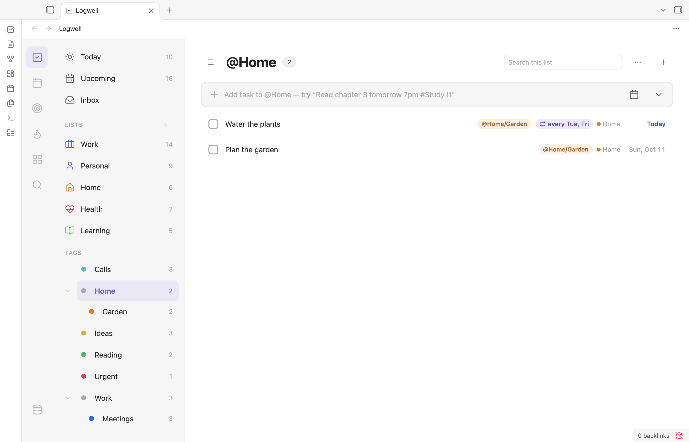

# Lists, sections and tags

Every task is in exactly one list, such as Work, Home or Errands. Sections split a list into groups, such as Planning and Review. Tags are labels such as `@home`, and a task can have any number of them.

## Create a list

A task goes to Inbox unless you choose another list. You can rename Inbox and change its icon and color, but you cannot delete it. To add your own list:

1. Click **New list**, the plus button next to Lists in the sidebar.
2. Type a **Name**. Names must be unique, ignoring capitals.
3. Pick an **Icon**, or none. **Search icons** finds more.
4. Pick a **Color**. The next palette color is preselected. **Default** means no color.
5. Choose **Create**.

Quick Add never creates a list: a `#name` that matches no list must be resolved first. See [Quick Add](quick-add.md).

## Edit, reorder or delete a list

Right-click a list in the sidebar, or focus it and press the context-menu key or Shift+F10:

- **Edit** renames it. Its tasks stay in it.
- **Change icon…** and **Change color…** open the pickers. **None** clears either.
- **Sync with TickTick…** and **Unlink from TickTick**: see [TickTick sync](ticktick-sync.md).
- **Move up** and **Move down** change its place in the sidebar.
- **Delete** asks first and says how many tasks will move to Inbox. Its sections are deleted too. The notice offers **Undo**. If Inbox is [synced with TickTick](ticktick-sync.md#limits) and the move would give it more than 999 open tasks, the delete is refused.

## Put a task in a list

Add the task from the list's view, type `#name` in Quick Add (`Pay rent friday #Home`), or choose **Move to list…** in the row menu.

A subtask always stays in its parent's list and section, and moves with its parent.

## Add a section

Inbox and every list can have sections.

1. In the list's view, click **View options** (the ⋯ button) and choose **Add section**. On the board you can also click **Add section** after the last column.
2. Type a name and press Enter. Escape closes the field.

Section names must be unique within the list, ignoring capitals.

## See your sections

In the list layout, choose **View options**, **Group by…**, then **Section**. Adding a section picks this grouping for you. "No section" comes first, then each section, even an empty one. Click a heading to collapse it.

## Move a task into a section

- Drag the task into the section, in the list or on the board.
- Choose **Move to section…** in the row menu, then a section or **No section**. It shows for top-level tasks when the list has sections.
- Click the plus button on a section's heading or column to add a task to it.

Moving a task to another list clears its section.

## Rename, reorder or delete a section

Click the ⋯ button on a section's heading or column:

- **Rename** asks for the new name.
- **Move left** and **Move right** move it one place. On the board you can also drag the column's header.
- **Delete** removes the section at once. Its tasks move to "No section", and the notice offers **Undo**.

"No section" always stays first and has no menu.

## Work on a board

In a list, the board shows each section as a column of cards that you drag between. See [Board](board.md).

## Tag a task

- Type `@name` in Quick Add, such as `Buy groceries @errands`. A tag that does not exist is created when you add the task.
- In the details pane, click **Add tag** (the plus button) under **Tags** and type a name. Click **Add** for an existing tag or **New tag: name** to create one. The × on a tag removes it.
- In the add bar, open **Priority, list, tags and note**, then **Tags**, to pick existing tags.

A tag name may contain letters, digits, `-`, `_` and `/`, and a new name has at most 64 characters. Tags ignore capitals: `@Home` and `@home` are the same tag, shown with the spelling you used first. In Quick Add, a name that is too long stays in the title as text. A longer tag already in your database keeps working.

## Create a tag

1. Click **New tag**, the plus button next to Tags in the sidebar. The Tags heading shows even before you have a tag.
2. Type a **Name**: one word of letters, digits, hyphens (-) and underscores (_), such as `phone-calls`. Leave out the `@`.
3. Pick a **Parent**, or **None** for a top-level tag. Any top-level tag can be a parent.
4. Pick a **Color**. The next palette color is preselected. **Default** means no color.
5. Choose **Create**. The notice offers **Undo**.

The name is checked as you type, and **Create** stays off until it is valid. A message under the name says what to change, such as "The name "Calls" is already used by another tag."

## Nest tags

A slash makes a path: `@home/garden` sits under home. Tags nest one level deep. A deeper tag already in your database keeps working.

<picture>
  <source media="(prefers-color-scheme: dark)" srcset="images/tags-dark.png">
  
</picture>

- The sidebar shows your tags as a tree under the Tags heading. The chevron beside a parent folds its children.
- Click a tag to see its tasks. A parent's view and its count of open tasks include its children, and each task counts once.
- Every tag in the tree is a tag of its own, with a color and the same menu. Creating `@home/garden` creates `home` too when it does not exist yet, in the same step.
- `@home/garden` does not also tag a task `@home`.
- Outside the sidebar tree a tag shows just its own name: `@garden`, not `@home/garden`. Type it the same way in Quick Add, the tag field and a task block. Two tags that already share a name (older databases only) show their full paths, so each stays distinct.
- Adding a task from a tag's view gives it that tag, a parent's too.

A tag name is used once, whatever its parent. If `home/calls` exists, you cannot create `work/calls`: Logwell says "The name "calls" is already used by another tag." A tag cannot repeat its parent's name either, as in `home/home`. In Quick Add, such an `@name` stays in the title as text. Tags that already share a name keep working.

## Edit a tag

Right-click a tag in the sidebar, or focus it and press the context-menu key or Shift+F10, and choose **Edit**. The dialog is the one from **New tag**, filled in:

- Change the **Name** to rename the tag on every task, including tasks in the Trash. Renaming a parent renames its children's paths too: `@home/garden` becomes `@house/garden`.
- Change the **Parent** to move the tag under a top-level tag, or choose **None** to move it to the top. A tag with child tags has no parent, so its Parent stays **None**.
- Change the **Color**.
- Choose **Save**. Everything changes in one step, and the notice, such as "Renamed tag @Calls to @Phone.", offers **Undo**.

A name that another tag already uses is refused: two tags are never merged. If the tag's view is open, it stays open under the new name. A tag filter in the calendar, the matrix or Search, and a tag picked in an open add bar, let go of the old name; pick the tag again under its new name.

Renaming a tag does not change `tag:` lines in your notes; edit them yourself. See [Task block](dashboard-block.md). With [TickTick sync](ticktick-sync.md), the tasks go up with the new name, and nothing is renamed in TickTick.

## Color or delete a tag

Right-click a tag in the sidebar, or focus it and press the context-menu key or Shift+F10. Choose **No color** or a color, such as **Color: green**, or **Delete**.

Delete asks first, then removes the tag from every task, including tasks in the Trash, with **Undo**. Deleting a parent moves its child tags to the top level: `@home/garden` becomes `@garden` on every task, in the same step. If a child's view is open, it stays open under the child's new place. If a child would land on a tag that already has its name, as `@home/calls` beside an older `@calls`, the delete is refused with "The name "calls" is already used by another tag." Rename one of them first.

To show only tasks with chosen tags in Search, the calendar or the matrix, see [Views](views.md).
