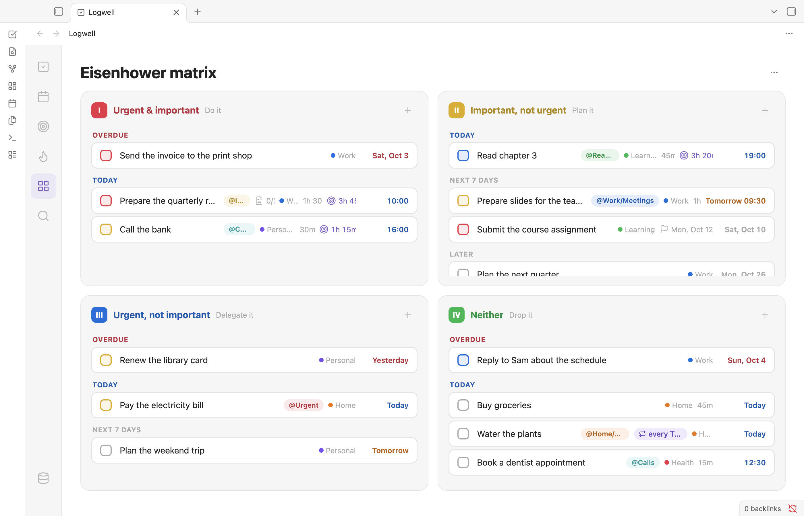

# Eisenhower matrix

The Eisenhower matrix sorts your tasks by two questions: is it urgent, and is it important? Each task lands in one of four quadrants, so you can see what to do first, what to plan, what to hand off and what to drop.

Open it with **Matrix** in the rail, or with the command **Open matrix**.

<picture>
  <source media="(prefers-color-scheme: dark)" srcset="images/matrix-dark.png">
  
</picture>

## Understand the quadrants

| Quadrant | Position | Flags | Subtitle |
| --- | --- | --- | --- |
| I, **Urgent & important** | Top left | Urgent and important | Do it |
| II, **Important, not urgent** | Top right | Important only | Plan it |
| III, **Urgent, not important** | Bottom left | Urgent only | Delegate it |
| IV, **Neither** | Bottom right | No flags | Drop it |

A task starts with no flags, in **Neither**, until you set them. Only the two flags decide the quadrant. A task's date, deadline or priority never moves it.

When the Logwell view is narrow, the quadrants stack in one column.

## Read a quadrant

Each quadrant groups its tasks by date, in this order:

- **Overdue**: the date or deadline has passed.
- **Today**
- **Next 7 days**
- **Later**
- **No date**
- **Completed**: collapsed until you click it, newest first. Click **Show more** to see more rows.

A task's group comes from its date, or from its deadline when it has no date. A repeating task uses its current date. Inside a group, tasks with a date come first, earliest first, and the rest follow in the order you created them.

Empty groups are hidden. A quadrant with no tasks says "No tasks".

A subtask has its own flags, so it can sit in a different quadrant from its parent. Its card shows the parent's name in front of its title.

Click a card to open it in the details pane. When you tick a task, it stays in place for a moment, then moves to **Completed**.

## Narrow the matrix

Click **View options** (the ⋯ button) next to the title:

- **Lists…** shows only the lists you check. Pick as many as you like; the menu stays open between picks.
- **Tags…** does the same for tags.
- **Show completed** is on by default. Turn it off to hide completed tasks.

A dot on the button shows that lists or tags narrow the matrix.

## Add a task to a quadrant

Each quadrant has a **+** button in its header. It opens **Quick add task** with that quadrant's flags already set, so the task lands there. To set the flags in Quick Add yourself, see [Set values by hand](quick-add.md#set-values-by-hand).

## Move a task to another quadrant

Each way below sets the task's flags. The task keeps everything else. A drag shows a notice with **Undo**; to undo any other move, run the command **Undo last task change**.

### Drag a card

Drag a card onto another quadrant. The card stays dimmed in place while a copy follows the pointer. When you drop it, a notice says where it went and offers **Undo**.

- Press Escape to cancel a drag.
- Hold the card near the top or bottom of a long quadrant to scroll it.
- Dragging works with a mouse or pen. On a touch screen, use the menu or the details pane.

### Use the keyboard

Focus a card, then:

- Press 1, 2, 3 or 4 to send it to quadrant I, II, III or IV.
- Press Alt with an arrow key to move it to the next quadrant in that direction.

The card keeps focus after the move, and a screen reader announces where it went.

### Use the menus

- Right-click a card and choose one of the **Move to quadrant** items, such as **Move to quadrant: urgent and important**. The current quadrant is checked.
- In the details pane, pick a quadrant in the **Matrix** field.
- In the details pane, **More task actions** has **Urgent** and **Important**, which turn one flag on or off.
