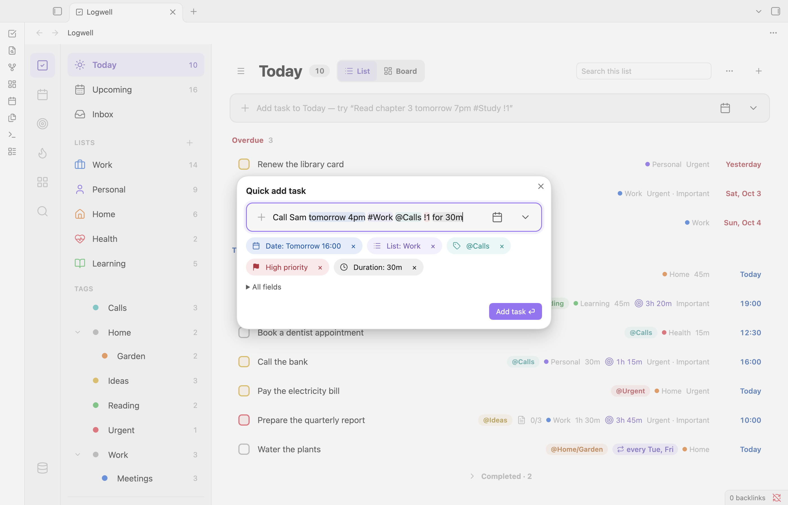

# Quick Add

Quick Add turns one line of text into a task. You type the title and its details together, and Logwell finds the date, list, tags, priority, duration, note and repeat as you type.

## Open Quick Add

You can type a new task in two places. Both read your text the same way.

- **The add bar** at the top of a list view. Press Enter to add the task; the bar stays for the next one. The view fills in defaults: in Today the task gets today's date, in a list it goes into that list, and in a tag view it gets that tag.
- **The Quick add task window.** Open it with the command **Quick add task** or the plus button in the list header. Enter adds the task and closes the window, unless **Keep quick add open after saving** is on.

Text you type while a task is still being saved stays in the field for the next task, and the window stays open with it.

The **Add subtask** bar in the details pane reads text the same way. See [Tasks](tasks.md).

<picture>
  <source media="(prefers-color-scheme: dark)" srcset="images/quick-add-dark.png">
  
</picture>

## See what Quick Add found

Each word Logwell recognizes is highlighted, shown as a chip under the input and taken out of the title. `Pay rent friday #Home @errands !1` becomes the title "Pay rent" with a date, a list, a tag and a priority.

- Press × on a chip to keep its words in the title as plain text.
- When you type the same kind of value twice, the later one wins. The earlier chip says "Replaced by a later value".
- Vague words, such as "next month", "this evening", "in may" or "sun", show as a suggestion such as "Use as date?". It applies only when you click it or press Enter on it.
- A date range, such as `Friday until midnight` or `Oct 12 to Oct 20`, is also a suggestion. Its date is the start as you would get it typed alone: `Friday until midnight` typed on a Wednesday suggests the coming Friday.
- A time range on one day, such as `Meeting 3-4pm`, `10am-11am`, `from 3pm to 5pm` or `2-3pm tomorrow`, sets the start time and the duration between the two times. A `for` duration you type wins. If the end is not after the start, as in `4-3pm`, only the end time is used.
- Some text has two readings, and the chip lets you choose. `at 5` asks for 05:00 or 17:00. `friday` typed on a Friday asks for Today or Next week. In a repeat, such as `every day at 7`, the task is not saved until you choose: Enter opens the choice, and choosing saves.
- If nothing is left of the title, Logwell keeps the full text as the title.
- Text like `#42` or `@5` stays in the title unless a list or tag with that name exists.
- To keep words as plain text, put them in double quotes: `Read "Friday night lights"` reads no date and keeps the quotes in the title. A backslash keeps the word or token after it as text, with any phrase that word starts, and is removed: `Buy \today paper` becomes "Buy today paper", `Pay \by friday` stays "Pay by friday" with no deadline, and `\#Work` stays "#Work".
- A comma or semicolon next to a recognized word is removed with it. Another mark, such as `-`, `.` or `!`, is removed when it stands alone at the start or end of what is left, and so are empty parentheses: `Pay rent - tomorrow` and `Pay rent (#Work).` become "Pay rent". A mark attached to a word stays, as in `Wow! tomorrow`.

## What you can type

| You want | You type | Notes |
| --- | --- | --- |
| A date | `today`, `tomorrow`, `in 3 days`, `next week`, `this weekend`, `the day after tomorrow` | `next week` is seven days from today. |
| | `friday`, `next fri`, `this monday`, `on friday` | A weekday means its next date. |
| | `Oct 5`, `5 Oct 2026`, `2026-10-05`, `10/5` | Without a year, the next such date: today's date is today, and `Feb 29` is the next leap day. A two-digit number after a comma is not a year: `Party May 5, 20 guests` is May 5 with "20 guests" in the title. The **Date order** setting decides what `10/5` means; with Day/month order, `from 12 Oct` is a date, and `Oct 15` is 15 October as in Month/day order. `a day` and `a week` alone, as in `3 times a day`, are not dates. |
| A date and time | `at 7pm`, `19:00`, `at noon`, `at 0900`, `@4pm`, `tomorrow at 7pm`, `in 2 hours` | A time without a date means the next such time. Four digits after `at` are a 24-hour time, also in a repeat or a range: `every day at 0900`, `at 0900-1000`. `@4pm`, `@4:30pm` and `@noon` work like `at`, as in `tomorrow @4pm`, unless you have a tag with that name. |
| | `tonight`, `tonight at 9` | Today at the **Evening time** setting (20:00 unless you change it), or at the time you type. |
| A deadline | `by friday`, `by Oct 9`, `by 5pm`, `until tomorrow` | `by` right before a date makes it a deadline, as does `until` before a date when the task does not repeat (`Wait until tomorrow`). |
| A planned duration | `for 45m`, `for 1h30m`, `for 90 min`, `for 1.5 hours`, `for half an hour` | From 1 minute to 24 hours. A longer value shows an error chip. Without `for`, as in `Gym 2h`, it stays in the title. |
| A list | `#Home`, `#Work` | The exact name wins. Otherwise capitals, spaces, `-` and `_` do not matter. If that finds several lists, the name counts as unknown. |
| A list and section | `#Work/Admin` | The Admin section of Work, matched like list names. It wins over the section of the view you add from. A section the list does not have stops the save. |
| A tag | `@errands`, `@home/garden` | Type a tag by its own name, like `@garden` for `home/garden`, or by its full path. A new tag is created when you add the task. A path whose name another tag already uses, like `@work/garden`, stays in the title. |
| A linked note | `[[Budget]]`, `[[Home/Budget]]`, `[[Budget\|alias]]` | Matches the note by path, then by name. |
| A priority | `!1` or `!high`, `!2` or `!medium`, `!3` or `!low` | It must be a separate word: `Wow!` and `!4` stay text. Punctuation around it is fine: `!1.`, `(!2)`. |

You can also type a repeat, its time, its first date and its end, such as `Pay rent every month on the 1st`, `Stretch daily at 7am` or `Pills every day until Dec 1`. A repeat it cannot make yet, such as `every 3 hours`, stays in the title, marked "Recurrence not supported yet", and is never read as a date. See [Repeating tasks](repeating-tasks.md#type-a-repeat) for every phrase you can type.

## Fix an unknown list or note

A `#list` that does not exist stops the save, because Logwell never creates a list from text. Press Enter and a picker opens with Inbox selected. Choose a list and the task is saved.

A `[[note]]` that matches several notes shows how many; open the chip to choose one. Saved without a choice, the task has no note and the text stays in the title.

Typing `#`, `@` or `[[` opens suggestions of your lists, tags and notes. After `#Work/` the suggestions are the sections of Work.

## Set values by hand

The add bar has two buttons.

- **Date** opens a popover with **Date** and **Duration** tabs. On **Date**, pick **Today**, **Tomorrow**, **Next week** or **Tonight**, or a day in the month, and set **Time**, **Deadline** and **Repeat**. On **Duration**, pick 15m, 30m, 45m, 1h, 1h30 or 2h, or type minutes. **Clear** removes the values and **OK** closes the popover.
- **Priority, list, tags and note** opens the priority flags and the rows **List**, **Tags**, **Description note** and **Matrix quadrant**.

Picked values show as pills next to the chips, with × to remove them. A value set by hand wins: typed text for it shows as a suggestion such as "Replace date?".

In the Quick add task window, **All fields** shows plain fields for **Date**, **Time**, **Deadline**, **Repeat**, **Duration (min)**, **List**, **Urgent** and **Important**, plus tags and **Link existing note**. **Time** needs a date first.

A repeating task has no deadline. If you add both, the task is saved without the deadline and a notice says so.

## Use the keyboard

- Enter adds the task.
- Tab moves from the input to **Date**, the more button and then the chips.
- Left and Right move between chips. Enter opens or accepts a chip, and Delete or Backspace keeps its text in the title.
- Escape closes an open popover or chip picker first, then the window.

## Daylight saving

A time that does not exist on a spring-forward day moves to the next valid time, with "Adjusted for daylight saving" on its chip. A time that happens twice on a fall-back day uses the first one, with "Ambiguous time; using first occurrence".
