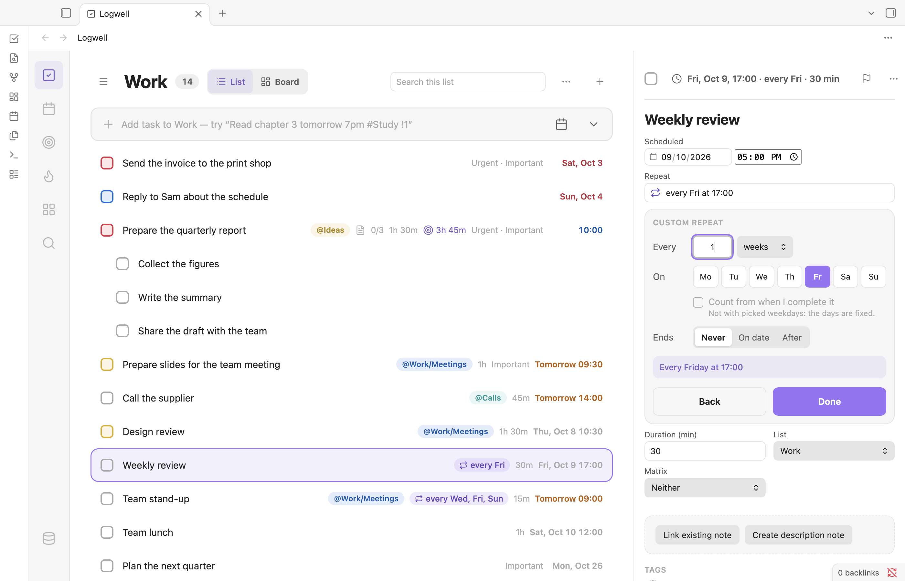

# Repeating tasks

A repeating task, such as "Pay rent" every month, stays one task: each time you complete it, Logwell records that date and moves the task to its next date.

<picture>
  <source media="(prefers-color-scheme: dark)" srcset="images/repeat-dark.png">
  
</picture>

## Make a task repeat

Type `every …` in Quick Add, such as `Pay rent every month on the 1st #Home`, or use the picker: the **Repeat** row in the add bar's date popover, or the **Repeat** field under **All fields** in the **Quick add task** window or in the details pane.

Pick **Never**, **Daily**, **Every weekday**, **Weekly**, **Monthly**, **Yearly** or **Custom…**. Weekly, Monthly and Yearly follow the task's date, which is also the first date (today if it has none). A weekly repeat on picked weekdays starts on the first of those weekdays on or after that date, so "every 2 weeks on Monday" made on a Wednesday first falls on the coming Monday. A yearly repeat on Feb 29 falls on Feb 28 in other years. Changing an existing repeat to Yearly keeps the month and day of the series' first date, which the picker shows. A task's time applies to every occurrence.

A subtask cannot repeat, but a repeating task can have subtasks: they come back unchecked each time. A repeating task has no deadline, so Logwell removes one and says so.

## Type a repeat

Quick Add reads a fixed set of phrases. A phrase from the tables below becomes the repeat; anything else stays in the title, and an `every …` it cannot make shows "Recurrence not supported yet" and is never read as a date.

| You type | It repeats |
| --- | --- |
| `every day`, `daily`, `every morning`, `every afternoon`, `every evening`, `every night` | Daily, with no time |
| `every 3 days`, `every other day` | Every 3 days, every second day |
| `every weekday`, `every workday`, `weekdays`, `workdays` | Monday to Friday |
| `every weekend`, `weekends` | Saturday and Sunday |
| `every week`, `weekly` | Weekly, on the weekday of the first date |
| `every 2 weeks`, `every other week`, `fortnightly` | Every 2 weeks |
| `every monday`, `every mon`, `mondays` | Weekly on Monday |
| `every other monday` | Every 2 weeks on Monday |
| `every mon, wed, fri`, `every mon wed fri`, `every mon and fri`, `every mon & fri`, `weekly on mon, fri`, `weekly mon, fri`, `every week on mon, fri` | Weekly on those days (`sat` and `sun` joined by plain spaces count only when no title words follow) |
| `every mon-fri`, `every monday to friday`, `every tue-thu`, `every week on mon-fri`, `weekly mon-fri`, `weekly on mon-fri` | Weekly on every day from the first to the last, round the week: `every fri-mon` is Friday, Saturday, Sunday and Monday |
| `every 2 weeks on mon, fri`, `every 2 weeks tuesday`, `every other week on tue` | Every 2 weeks on those days |
| `every month`, `monthly` | Monthly, on the day of the first date |
| `every 3 months`, `every other month` | Every 3 months, every second month |
| `quarterly`, `every quarter` | Every 3 months |
| `every 15th`, `every month on the 15th`, `every month on 15`, `monthly on the 15th`, `monthly on day 15`, `on the 15th of every month`, `the 15th of each month` | Monthly on the 15th |
| `every last day of the month`, `monthly on the last day`, `last day of the month`, `last day of every month` | Monthly on the last day |
| `every first friday`, `every second friday`, `every third friday`, `every fourth friday`, `every last friday`, `every 1st friday`, `every 2nd friday of the month`, `last friday of the month`, `the 2nd tuesday of every month`, `the 2nd tuesday of each month` | Monthly on that weekday (`the 2nd tuesday of the month`, without `each` or `every`, stays text) |
| `every year`, `yearly`, `annually` | Yearly, on the month and day of the first date |
| `every 2 years`, `every other year` | Every 2 years |
| `every year on May 5`, `yearly on May 5`, `annually on May 5` | Yearly, starting on that date; a date with no year is its next one, so Feb 29 starts on the next leap day |

A number is written in digits, from 1 to 999: `every 0 days` and `every 1000 days` are refused, and `every two weeks` is not read. A single word such as `daily`, `weekly`, `monthly`, `yearly`, `quarterly`, `weekdays` or `mondays` repeats only when its phrase ends the text: the word alone, or followed only by its `on …`, a time, a start or an end (`Pay rent monthly on the 1st`, `Bday yearly on May 5`). So `Stretch daily` repeats, but `Daily standup` keeps its title.

Add a time with `at` right after the repeat, such as `every monday at 9am` or `daily at 7:30pm`. For a bare hour from 1 to 12, such as `at 9`, Quick Add asks whether you mean 09:00 or 21:00; the repeat applies once you choose, and the task is not saved before: Enter opens the choice, and choosing saves.

Set the first and last date in the same line, after the repeat and its time, in any order:

| You type | It does |
| --- | --- |
| `starting Oct 12`, `from Oct 12`, `beginning Oct 12`, `on Oct 15` (not after a weekly form, where `on` names the days: `every week on Oct 12` only offers the date with "Use as date?"; write `every week starting Oct 12`) | Starts on that date |
| `every day Oct 12`, `every day, Oct 12`, `every month Oct 15` | Starts on that date: a date right after the repeat, or after a comma, is read on its own |
| `until Dec 1`, `till Dec 1`, `ending Dec 1`, `ending on Dec 1`, `ends on Dec 1` | Ends on that date, the last occurrence included |
| `for 5 times` | Ends after 5 times |
| `for 2 weeks`, `for 3 mondays`, `for 6 months` | Ends that many weeks, Mondays or months after the first date: the date you type, pick or the view gives, else today |
| `from Oct 12 until Dec 1`, `from Oct 12 to Dec 1`, `starting Oct 12 to Dec 1`, `starting Oct 12 ending Dec 1`, `Oct 12 to Dec 1` right after the repeat | Starts on Oct 12 and ends on Dec 1 |
| `starting Monday until Friday`, `beginning Monday to Friday` | Starts on the coming Monday and ends on the Friday after it |

A start or an end counts only after the repeat: in `Wait until Friday then call the bank every monday`, `until Friday` is read as it would be without a repeat. An end must be a date: after a repeat, `until 5pm` is only offered with "Use as date?". An end with no year that comes before the start is the next one, so `starting Dec 20 until Jan 5` ends in January; an end more than a year past the start is offered with "Use as end date?". An end that leaves no occurrence, such as `every friday until Wednesday` typed on a Monday, is refused: its chip says so, the text stays in the title, and the task cannot be saved until you fix the end or remove its chip. A count goes up to 999 times. `for …` ends a repeat only after it: `Plan meals for 7 days every sunday` keeps "for 7 days" in the title. Two bare weekdays such as `Mon-Fri` or `from Monday to Friday` after a complete repeat, as in `every day Mon-Fri`, are neither a start and an end nor the repeat's days: they stay one "Use as date?" suggestion. Write `starting Monday until Friday` for a start and an end, or `every mon-fri` for those weekdays.

Not supported yet. These show "Recurrence not supported yet" and set nothing:

- Hourly or minute repeats: `every 3 hours`.
- Several times or patterns in one task: `every monday at 9 and friday at 5`, `every 2nd and 4th tuesday`, two `every` phrases.
- Exceptions: `every day except sunday`.
- Several days of the month: `every month on the 1st and 15th`.
- A fifth weekday: `every 5th friday`, `every fifth friday`.
- A repeat with two first dates: `every year on May 5 from Oct 12`.
- A start or an end after a repeat Quick Add cannot make, or a date right after it: in `every 8 hours starting tomorrow` and `every 8 hours tomorrow`, the date sets nothing either; a date right after it is only offered with "Use as date?".

These stay plain title text: `3 times a day`, `twice a week`, `biweekly`, `bimonthly`, `each monday`, `each day`, `the 1st of the month` without `each` or `every` (write `the 1st of each month`), and a day part after a weekday (`every sunday evening` repeats on Sunday; "evening" stays text). `every monday 9am` repeats on Monday and reads `9am` as a time on its own. Counting from completion is set in the picker.

A value you pick by hand wins: the typed one is offered as a "Replace …?" chip. Without a repeat, `until Dec 1` is a deadline, a range such as `Oct 12 to Dec 1` is one suggested date, and `ending`, `starting`, `till`, `beginning` and `from` stay part of the title. Picking **Never** counts as no repeat here, so `until Dec 1` is then a deadline. If you picked a repeat in the picker, a typed `until` date ends it (`for …` stays text), and an end that leaves the picked repeat no occurrence is refused the same way; when the picked repeat already has an end, the typed one is offered as a replacement. The title keeps everything that was not read, with no stray comma: `Read every day, 20 pages` becomes "Read 20 pages".

## Set a custom repeat

Choose **Custom…** in the picker:

- **Every**: a number from 1 to 999, and days, weeks, months or years. Years repeat on the month and day of the task's date; for a task that already repeats, the month and day of the series' first date, as the summary shows.
- **On**: for weeks, the weekday buttons; pick none to use the weekday of the task's date. For months, **Day N**, such as Day 15 (from the 29th on, a shorter month uses its last day), **The** first to fourth or last weekday, or **The last day of the month**.
- **Count from when I complete it**: see below.
- **Ends**: **Never**, **On date** or **After** 1 to 999 times.

Choose **Done** or **Back**. **Done** is off while a value is missing or the repeat would end before its first date.

Weeks begin on the **Week starts on** [setting](settings-and-commands.md) in force when you make the repeat.

## Count from when you complete it

By default the schedule is fixed: "every Monday" stays on Mondays however late you finish. With **Count from when I complete it**, the next date counts from the day you finish. With every 3 days, finishing on Oct 5 gives Oct 8, and finishing late on Oct 10 gives Oct 13. A skip counts from the day you skip. The option is off for fixed days: picked weekdays, a weekday of the month or the last day.

## End a repeat

**On date** allows occurrences up to that date. **After** N times counts completed and skipped occurrences. At the end, the task is completed and the notice says "The series has ended." Logwell also completes series with no dates left, on open and hourly; an unfinished last occurrence stays overdue.

## Complete or skip an occurrence

Tick the checkbox, press Cmd+Enter (Ctrl+Enter) on the row, or choose **Complete** in the row menu. The task moves to its next date.

If you fall behind on a fixed schedule, completing marks the earliest missed date done and skips the others before today, and the notice says how many. A repeat that counts from completion never skips dates on its own.

**Skip this occurrence** in the row menu records the date as skipped. Every notice has an Undo button.

## Change or stop a repeat

**Edit repeat…** in the row menu opens the picker in the details pane. A change applies from today; past records keep their rule. **Never** turns the task into a plain task on its current date.

**Stop repeating** asks you to confirm, then completes the task, keeping its history. Reopening it makes it repeat again.

## Move a repeating task to another day

Changing the date in the **Scheduled** field, with **Schedule for today**, **Schedule for tomorrow** or **Schedule for next week**, or by dragging on a board or list moves the whole series to repeat from that date. An end that leaves no occurrence is removed. You cannot move one occurrence alone or clear the date. A repeat that has ended, after **Stop repeating** or at its end, cannot get a new date: reopen the task first.

## Review and reopen past occurrences

Each completed occurrence adds a row to the Completed group of the task's views. Right-click it for **Open details** or **Reopen**, which makes the date due again and reopens a series that record had ended. Skipped occurrences are not listed. See [Views](views.md).

## In lists and the calendar

**Today** lists the task while its current date is today or earlier, and **Upcoming** lists it once. The [matrix](matrix.md) uses its current date. The [calendar](calendar.md) shows its occurrences.

## Duplicate or delete a repeating task

**Duplicate** makes a copy without history, starting on the current occurrence if that is not past, else the next date from today. It keeps the end, unless the end would come before the copy's first date: then the copy never ends. A copy of a yearly repeat on Feb 29 repeats on Feb 28, so in leap years it is one day before the original. **Delete** moves the task and its history to the Trash; deleting it for good removes both. The [CSV export](export.md) lists every done or skipped occurrence.
