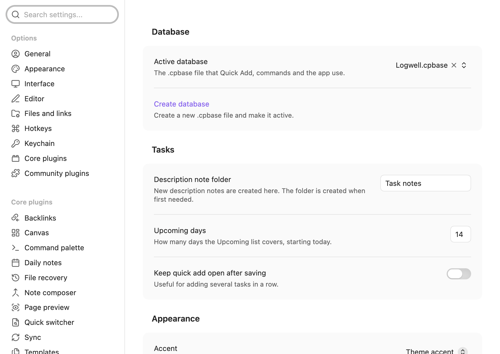

# Settings and commands

Settings let you choose the active database and adjust how Logwell reads dates, shows tasks and plays sounds. Commands let you reach Logwell from the command palette or your own hotkeys.

## Change a setting

Open Settings, then Logwell. Each change is saved and applied at once. Your settings are kept with the plugin, so a vault sync tool can carry them to your other devices.

<picture>
  <source media="(prefers-color-scheme: dark)" srcset="images/settings-dark.png">
  
</picture>

### Database

| Setting | What it does | Default |
| --- | --- | --- |
| **Active database** | The `.cpbase` file that Quick Add, commands and the app use. Pick a file from your vault. Changing it opens that database. | None until you create one |
| **Git sync** | Stops Git from merging the database line by line, so a conflict offers **Keep mine** or **Keep theirs**. **Add to .gitattributes** adds the line `*.cpbase merge=binary -text` to the `.gitattributes` file at the top of your vault. Shown only in a vault with a `.git` folder and no such line yet; in a vault inside a larger repository, add the line at the repository root. See [Git](your-data.md#git). | |
| **Create database** | Creates a new `.cpbase` file in a folder you choose and makes it active. See [Create your database](getting-started.md#create-your-database). | |

### Tasks

| Setting | What it does | Default |
| --- | --- | --- |
| **Description note folder** | The folder where **Create description note** puts new notes. It is created the first time it is needed. | `Task notes` |
| **Upcoming days** | How many days the Upcoming view covers, starting with tomorrow. From 1 to 60. | 14 |
| **Keep quick add open after saving** | Keeps the Quick add task window open after you add a task, so you can add several in a row. | Off |

### Appearance

| Setting | What it does | Default |
| --- | --- | --- |
| **Accent** | **Theme accent** follows your Obsidian theme. **Purple**, **Blue**, **Green** and **Orange** keep a fixed color whatever the theme. | Theme accent |

### Focus

| Setting | What it does | Default |
| --- | --- | --- |
| **Sound theme** | The sound for the start of a focus round, the start of a break and a finished set: **Chime**, **Soft**, **Digital** or **None**. | Chime |
| **Sound volume** | From 0 to 100, in steps of 5. | 60 |
| **Play** | Plays the three sounds of the current theme at the current volume. | |
| **Skip focus rounds under a minute** | A round you end with **Stop** or **Finish** within a minute is not saved. A notice offers **Undo**. | On |

You set the length of a focus round, the breaks and the number of rounds on the Focus page. See [Focus](focus.md).

### Time

| Setting | What it does | Default |
| --- | --- | --- |
| **Time zone** | An IANA zone such as `Europe/Berlin`. Leave it empty to use the device zone, which the field shows. Times and "today" follow this zone. | Device zone |
| **Week starts on** | **Monday**, **Sunday** or **Saturday**. The calendar, the date picker, the habit week and weekly repeats use it. | Monday |
| **Evening time** | What "tonight" means in Quick Add and the date picker: today at this time, as 24-hour HH:mm. It is also when the Evening group starts on the [Habits](habits.md) page. | 20:00 |
| **Date order** | How Quick Add reads dates such as 10/5: **Month/day (10/5 is October 5)** or **Day/month (10/5 is 5 October)**. | Month/day |

### TickTick sync

Sync stays off until you add a token and turn it on for a device. See [TickTick sync](ticktick-sync.md).

| Setting | What it does | Default |
| --- | --- | --- |
| **TickTick token** | The secret in Obsidian's secret storage that holds your TickTick API token. The token is never stored in your vault. | None |
| **Sync with TickTick on this device** | Turns sync on for this device only. It is unavailable until a database is open and a token is set. | Off |
| **Pull from TickTick every** | Minutes between pulls, from 5 to 60. Your edits are sent within a few seconds whatever this is. Available while sync is on. | 5 |
| **Create notes from TickTick descriptions** | A synced task's TickTick description becomes a note in the description note folder. See [Description notes](ticktick-sync.md#description-notes). Available while sync is on. | Off |

While sync is on, the group also shows when the last sync ran, with **Sync now**, and each linked list, with **Unlink**.

## Run a command

Open the command palette and type the command's name. Obsidian shows each one with the plugin name in front, as in "Logwell: Quick add task".

| Command | What it does |
| --- | --- |
| **Quick add task** | Opens the Quick add task window. See [Quick Add](quick-add.md). |
| **Open app** | Opens the app on the Tasks section. |
| **Open today** | Opens the Today view. |
| **Open calendar** | Opens the Calendar. |
| **Open habits** | Opens the Habits page. |
| **Open matrix** | Opens the Eisenhower matrix. |
| **Open search** | Opens the Search page. |
| **Open focus** | Opens the Focus page. If the timer is waiting for an answer after an interruption, it asks again. |
| **Start focus on selected task** | Starts a focus set on the task selected in the app. It says "Select a task first." when none is selected. |
| **Pause or resume focus** | Pauses a running timer or resumes a paused one. If the timer is waiting for an answer after an interruption, it asks that question. Shown while a timer exists. |
| **Stop focus** | Stops the running focus set. Shown while a timer exists. |
| **Create database** | Creates a new database and makes it active. |
| **Undo last task change** | Reverts the latest change you made in Logwell and says what was undone, or "Nothing to undo." |
| **Sync with TickTick now** | Pulls from and pushes to TickTick for every linked list at once. Shown while a token is set, sync is on for this device, a list is linked and the database can be written. |

If no database is active, a command that needs one shows "No Logwell database is active." with a **Create database** button.

## Give a command a hotkey

Logwell sets no default hotkeys. To add one, open Settings, then Hotkeys, search for Logwell and click the plus next to the command.

## Other ways in

- The ribbon has an **Open Logwell** icon, which opens the app on Tasks, or switches to its tab if it is open.
- When Obsidian starts and no database is active, Logwell shows a notice that says "Logwell keeps your tasks in a database file. Create one to get started." with a **Create database** button.
- On desktop, a status bar item shows a running focus timer. Click it to open the Focus page.
