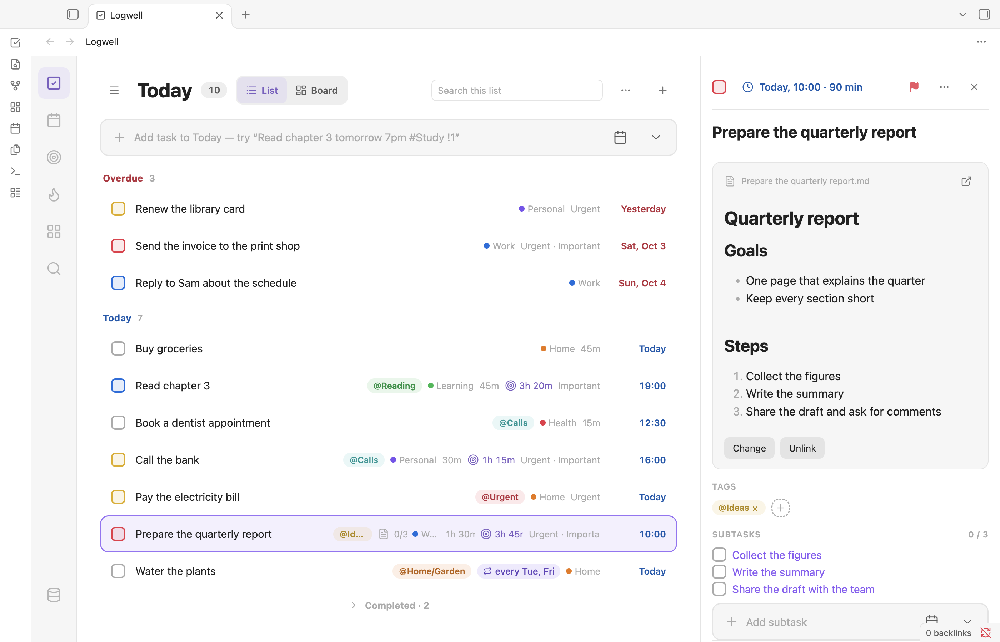

# Tasks

A task is something you want to do, such as "Pay rent". It has a title and can have a date, a deadline, a list, tags, a priority, subtasks and a linked note.

## Add a task

Type in the add bar at the top of a list view and press Enter, or run the command **Quick add task**. You can type details with the title, such as `Pay rent friday #Home`. A title alone creates a task in Inbox with no date. See [Quick Add](quick-add.md).

## Read a task row

<picture>
  <source media="(prefers-color-scheme: dark)" srcset="images/today-dark.png">
  
</picture>

Right of the title, a row shows what the task has: its first tag and a count, a note icon, a repeat chip such as "every Fri", subtasks done out of total, the list (outside its own view), the deadline, the duration, the time focused, "Urgent" or "Important", and the date. Overdue dates are red, today's blue and tomorrow's orange. The checkbox takes the priority color: red for high, yellow for medium, blue for low.

On the keyboard, Up and Down move between rows, Enter or Space opens the details, Cmd+Enter (Ctrl+Enter on Windows and Linux) completes, and the context-menu key or Shift+F10 opens the row menu.

## Edit a task in the details pane

<picture>
  <source media="(prefers-color-scheme: dark)" srcset="images/task-details-dark.png">
  
</picture>

Click a row to open its details. From top to bottom you see:

- The checkbox, the date chip, a priority flag, **More task actions** and **Close details**. Click the date chip to show or hide the date fields.
- The title. Edit it in place; an empty title brings back the old one.
- **Subtask of** and the parent's title, for a subtask.
- The date fields: **Scheduled**, **Repeat**, **Deadline**, **Duration (min)**, **List** and **Matrix**.
- The description note.
- **Tags**, with a plus button to add one.
- **Subtasks**, with the **Add subtask** bar.
- The list button, the time focused and **Focus**, which starts a [focus timer](focus.md).

**More task actions** holds **Duplicate**, **Make subtask of…**, **Make top-level task**, **Urgent**, **Important**, **Show ID and timestamps** and **Delete**.

Right-click a row for the row menu: **Open details**, **Complete**, **Start focus**, the **Schedule for** items, **Clear schedule**, the priorities, **Move to list…**, **Move to section…**, the **Move to quadrant** items, **Duplicate** and **Delete**.

## Set a date, a deadline and a duration

- **Scheduled** is when you plan to do the task: a date, or a date and a time.
- **Deadline** is when it must be done. It is separate from the scheduled date.
- **Duration (min)** is the planned length, from 1 to 1440 minutes. The [calendar](calendar.md) sizes the task's block by it.

Times show in the zone of the **Time zone** setting, your device zone unless you set one. [Views](views.md) explains which tasks Today and Upcoming show.

## Set a priority

A priority is none, high, medium or low. Set it with the flag in the details pane, the row menu, or `!1`, `!2` or `!3` in [Quick Add](quick-add.md). Priority never changes the task's [matrix](matrix.md) quadrant.

## Add subtasks

A task can have subtasks, one level deep.

- Type in the **Add subtask** bar in the details pane. It reads dates, tags and priority like Quick Add. A typed `#list` stays in the title, because a subtask always stays in its parent's list and section.
- Or choose **Make subtask of…** in **More task actions** and pick the parent. **Make top-level task** turns it back.
- Completing the last subtask leaves the parent open. Completing a parent with open subtasks asks first: **Complete all (N)** completes them together.
- A subtask cannot repeat. A repeating task can have subtasks, and they come back unchecked with each new date. See [Repeating tasks](repeating-tasks.md).

## Link a description note

A task can link one note in your vault for its long description. The note stays an ordinary note, and Logwell stores only its path.

- **Link existing note** picks a note from your vault.
- **Create description note** makes an empty note named after the task in the **Description note folder** ("Task notes" unless you change it) and opens it. The folder is created when needed. A taken name gets a number, such as "Pay rent (2)".
- The details pane shows the note and updates as you edit it. **Open note** opens it in a tab; hold Alt for a split.
- **Change** links another note and **Unlink** removes the link.
- When you rename or move the note in Obsidian, the link follows.
- When the note is gone, the pane says "Description note not found" with **Relink** and **Unlink**. If one note has the same name, **Relink to** offers it.
- Several tasks can link one note. The pane lists the others under "Also linked from".

Logwell never copies, edits or deletes your notes, except a note that [TickTick sync](ticktick-sync.md) creates.

## Complete or reopen a task

Click the checkbox, press Cmd+Enter (Ctrl+Enter) on a focused row, or choose **Complete** in the row menu. Click the checkbox again to reopen the task; its subtasks stay as they are. Completing a repeating task completes one date and shows the next.

## Duplicate or delete a task

**Duplicate** makes an open copy below the task, with the same details, the same note link and copies of its subtasks.

**Delete** moves the task and its subtasks to the Trash, and a notice offers **Undo**. When the task has subtasks, you confirm with **Move to trash** first.

The Trash keeps a deleted task for 30 days; then it is deleted for good. To bring one back, see [Restore a deleted task](views.md#restore-a-deleted-task).

## Undo

Most changes show a notice with **Undo**. You can also press Cmd+Z (Ctrl+Z) in the app outside a text field, or run the command **Undo last task change**. Logwell keeps the last 50 changes. Undo refuses when something it would change was edited since. A change that cannot be undone because it was edited since is dropped from the history; the next Undo takes the change before it. Undoing a new or renamed tag is refused when a task synced from TickTick now uses that tag; rename it back with **Edit** instead. While the database is read-only, Undo is refused like every other change. The Undo button on a notice undoes only that change; if another change was made since, it says so instead. Following note renames, deleting permanently, emptying the Trash and the 30-day clean-up cannot be undone.
