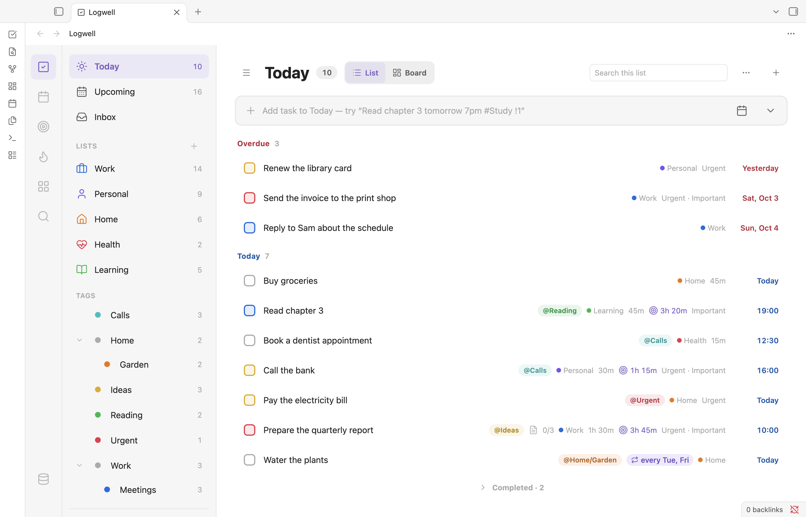
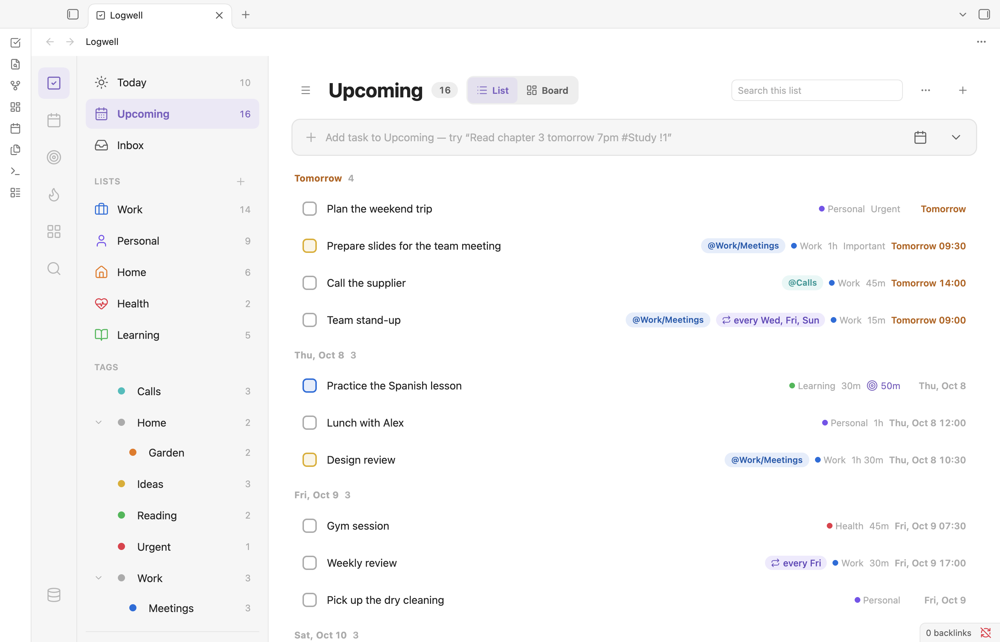
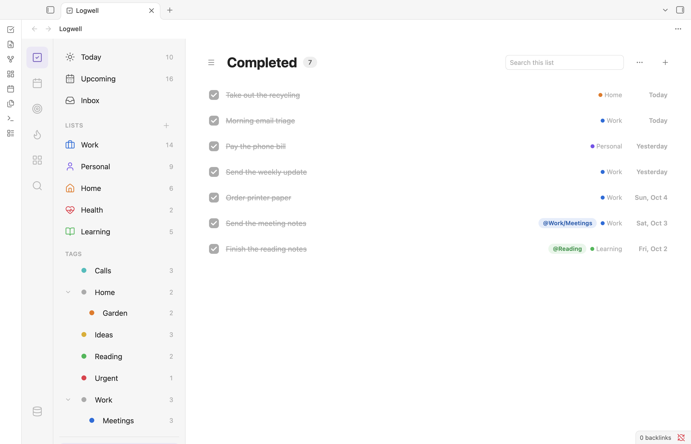

# Views

Views show your tasks from different angles: what is due today, what comes next, one list, one tag or what you have finished. Pick a view in the sidebar of the Tasks section, then sort, group, search or switch it to a board.

<picture>
  <source media="(prefers-color-scheme: dark)" srcset="images/today-dark.png">
  
</picture>

## Find your way around

The rail on the left opens the sections: **Tasks**, **Calendar**, **Focus**, **Habits**, **Matrix** and **Search**, with **Data** at the bottom. Each section stays as you left it while you visit another.

In the Tasks section, the sidebar lists **Today**, **Upcoming**, **Inbox**, your lists, your tags, **Completed** and **Trash**. The number next to a view counts its open tasks. Next to **Trash** it counts the deleted items.

Click a task to open its details. See [Tasks](tasks.md).

## See what is due today

**Today** shows your open tasks with a date or a deadline of today or earlier. Tasks from earlier days sit under **Overdue**, the rest under **Today**. In other views a past date shows in red on the row.

If you have habits, they sit above the list. See [Habits](habits.md#habits-in-today).

## Plan the coming days

**Upcoming** shows your open tasks dated from tomorrow on, grouped by day. The [**Upcoming days**](settings-and-commands.md) setting sets how many days it covers (14 by default). A task that is due today or overdue stays in **Today**, even if it has a later date too. A repeating task shows once, on its next date.

<picture>
  <source media="(prefers-color-scheme: dark)" srcset="images/upcoming-dark.png">
  
</picture>

## Open a list or a tag

**Inbox**, each list and each tag show their open tasks. See [Lists, sections and tags](lists-and-tags.md). In **Today** and **Upcoming**, a subtask is its own row, with its parent's name in front.

## Review what you finished

**Completed** lists every completed task, newest first. A repeating task adds one row for each time you completed it, such as "Weekly review · Fri, Oct 9". That row's menu has **Open details** and **Reopen**, and its checkbox reopens that date. See [Repeating tasks](repeating-tasks.md#review-and-reopen-past-occurrences).

<picture>
  <source media="(prefers-color-scheme: dark)" srcset="images/completed-dark.png">
  
</picture>

The other views end with a collapsed group, such as **Completed · 3**, with the completed tasks the view showed while they were open. In **Today** that includes overdue tasks you completed today. Click the group to open it; **Show more** adds 20 tasks at a time. A completed subtask stays under its open parent.

A task you complete stays a moment where it was, an overdue one under **Overdue** too, then moves into the group. To hide the group in every view, open **View options** (the ⋯ button) and turn off **Show completed**.

## Restore a deleted task

**Trash** holds deleted tasks until they are removed for good. See [Duplicate or delete a task](tasks.md#duplicate-or-delete-a-task) for how long they stay.

1. Click **Trash** in the sidebar.
2. Click **Restore** next to a task to put it back, with its subtasks. A task whose list is gone returns to Inbox, one whose section is gone goes to No section, and tags that no longer exist are dropped.
3. To remove one for good, click **Delete permanently** and confirm. To remove them all, click **Empty trash** and confirm.

## Search inside a view

Type in **Search this list** in the header to show only tasks whose title contains the text. The box clears when you change view.

## Sort a view

Open **View options** and pick a sort:

- **Sort: default** is your own order. Drag rows to change it.
- **Sort: by date** puts the earliest date first and tasks without a date last.
- **Sort: by priority** lists High, Medium, Low, then no priority.

The sort applies to every view in the Tasks section. Your own order is shared by every view; see [Board](board.md#reorder-cards-and-columns).

## Group a view

In the list layout, open **View options**, choose **Group by…** and pick a grouping. Each view offers its own choices:

| View | Choices | Default |
| --- | --- | --- |
| Today and Upcoming | **Date**, **List**, **Priority**, **Tag**, **None** | Date |
| Inbox and lists | **None**, **Section**, **Date**, **Priority**, **Tag** | None |
| Tags | **None**, **Date**, **List**, **Priority** | None |

**Tag** lists each task once, under its first tag. **Section** shows every section, even an empty one; see [Lists, sections and tags](lists-and-tags.md#add-a-section).

## Drag a task to another group

In Today, Upcoming, Inbox, lists and tags:

- Drag a row up or down to reorder it. This works under **Sort: default**. A parent moves with its subtasks. Only the row you drag moves: every other task keeps its place in every view, including tasks of the same list that this view does not show.
- Drag a row onto another group to change that value: its day, priority, section or list. A new day keeps the task's time. This works under every sort.

**Overdue**, **No date** and tag groups take no drops. After a move, a notice such as "Moved "Pay rent" to High." offers **Undo**.

## Switch to a board

Today, Upcoming, Inbox and lists have a **List** and **Board** switch in the header. See [Board](board.md).

## Search everything

Open **Search** from the rail, or run **Open search**, and type in the box. Results come under **Lists**, **Habits** and **Tasks**. Click a result to open it. When the results mix open and completed tasks, the completed ones sit in a collapsed **Completed** group at the end.

Turn on **Also search description notes** to match linked notes too. Logwell never stores their text. Matches update when you type, when a linked note changes, and when you return to Search.

Click **Show filters** to narrow the results by **Lists**, **Tags** (**Any** or **All** of them), **Date** (up to a **Date range**), **Status**, **Description note**, **Priority** and **Matrix** quadrant. A task must match every choice. **Sort by** picks **Default order** or **Priority**. **Clear filters** resets the filters and keeps the sort.

For the calendar's and the matrix's own **View options**, see [Calendar](calendar.md) and [Eisenhower matrix](matrix.md).

## Use a narrow window

In a narrow window the details open over the list and the sidebar hides: click **Show lists** to open it. In a wide window, **Hide lists** gives the list more room.
